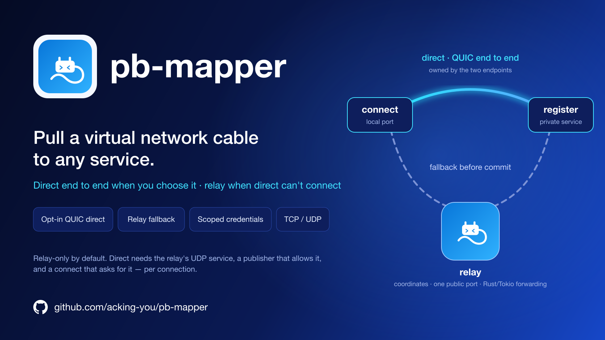
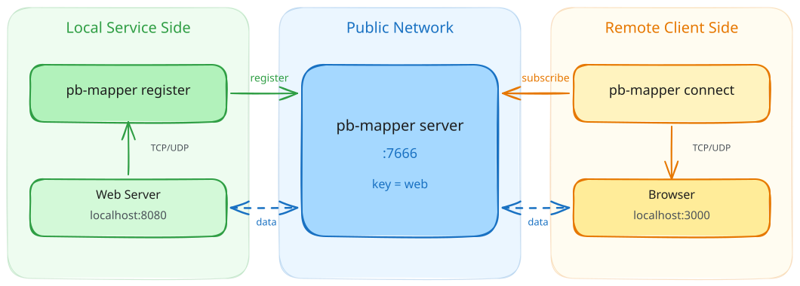

<div align="center">



<p>
  <a href="https://www.rust-lang.org/"></a>
  <a href="https://tokio.rs/"></a>
  <a href="https://flutter.dev/"></a>
  <a href="LICENSE"></a>
  <a href="https://github.com/acking-you/pb-mapper/releases"></a>
  <a href="https://github.com/acking-you/pb-mapper/actions/workflows/release.yml"></a>
  <a href="https://github.com/acking-you/pb-mapper/actions/workflows/docker-publish.yml"></a>
  <a href="https://github.com/acking-you/pb-mapper/stargazers"></a>
</p>

<p>
  <a href="README.md"><b>English</b></a> ·
  <a href="README.zh-CN.md">中文</a>
</p>

</div>

---

> **Pull a virtual network cable to any service.**

**pb-mapper** is a connection coordination layer. Run `register` next to a
private TCP or UDP service, run `connect` wherever you need it, and that service
appears on a local port, as if a cable ran between the two machines. One public
relay port authenticates both ends, scopes them to a namespace and decides how
their bytes travel.

- **Relay by default.** Every connection works through the relay: Rust on
  Tokio, TCP and UDP, optional AES-256-GCM per leg. Nothing new is negotiated
  unless you ask for it.
- **Direct when you choose it.** A connection that opts in first tries an
  end-to-end path: UDP hole punching on one socket, then mutually authenticated
  QUIC. Its bytes then bypass the relay, and the session belongs to the two
  endpoints: losing the coordinator does not cut it.
- **Relay again when direct cannot connect.** If no direct path is ready within
  the setup budget, the same connection falls back to the relay before any
  application byte is sent, pinned to the publisher that was selected, so the
  backend is never dialed twice.

pb-mapper transports bytes. The service behind a tunnel still owns its
application-level authentication and authorization.

## Why use it

- **One public port, many services** — registration, subscription, status and
  administration all enter through the same relay port. Adding a service does
  not require another public listener.
- **Delegate access instead of the root key** — keep one 32-byte administrator
  key on the relay and issue renewable, expiring `pbmt1_` credentials. Each
  credential receives an isolated namespace.
- **Revoke live access** — expiry, revocation, auth-state reset and root-key
  rotation close affected relay connections and refuse new direct setups.
- **Compact and embeddable** — one Rust binary holds the relay, register,
  connect, status and administrator roles; Rust and Node SDKs embed the same
  client.
- **Built for remote control** — agent harnesses, coding sessions, private APIs,
  model gateways, development machines and game servers reach private runtimes
  through it today.

Recovery behavior, resource bounds and fault-injection coverage are documented
in [Weak-network recovery](docs/weak-network-recovery.md).

## One relay, many private services



```text
 private runtime A ── register "app" ──┐
 private runtime B ── register "shell" ├──► pb-mapper relay :7666 ◄── connect
 private runtime C ── register "tools" ┘          one public port
```

- The relay matches both sides by namespace and service name.
- Different temporary credentials can reuse the same service names without
  seeing or colliding with each other.

## How a connection picks its path

Direct is decided per connection, and only when all three sides agree:

| Relay server | `register` | `connect` | Path |
| --- | --- | --- | --- |
| default | any | any | relay |
| `--enable-direct` | default | any | relay |
| `--enable-direct` | `--allow-direct` | default (`--path relay-only`) | relay |
| `--enable-direct` | `--allow-direct` | `--path auto` | direct first, relay fallback before commit |

```sh
pb-mapper server --port 7666 --enable-direct \
  --direct-listen 0.0.0.0:10811 --direct-advertise PUBLIC_IP:10811
pb-mapper register tcp --key demo --addr 127.0.0.1:8080 \
  --server relay.example.com:7666 --allow-direct
pb-mapper connect tcp --key demo --addr 127.0.0.1:9090 \
  --server relay.example.com:7666 --path auto
pb-mapper status sessions --server relay.example.com:7666
```

Open the advertised UDP port in addition to the TCP relay port. Credentials are
configured as before, and an omitted option keeps the original protocol and
control behavior, so existing clients and deployments are unaffected.

What to expect:

- **Fallback has one boundary.** The publisher dials its backend only after the
  consumer commits to direct. Before that point any failure falls back to the
  relay; after it, nothing is replayed onto the relay, since that could
  duplicate the backend's side effects.
- **Direct sessions belong to the endpoints.** Stopping the relay or revoking a
  credential blocks new setups but does not close an established direct
  session; stopping the local tunnel does. `status sessions` reports endpoint
  observations with age and staleness, not proof of liveness.
- **Not every network can be punched through.** Symmetric NATs, UDP blocking
  and similar paths use the relay. Validation so far: direct TCP and UDP
  across two independent Linux NATs, relay fallback with UDP blocked and no
  duplicate backend connection, and a macOS-to-Internet run that fell back to
  the relay. See the [validation record](docs/issue-13-validation.zh-CN.md) and
  the [design](docs/issue-13-direct-connect-design.zh-CN.md).

Rust SDK users enable the `p2p` feature and call `register_with_options` /
`connect_with_options`; Node exposes `allowDirect`, `path` and `sessionsJson()`.
The Flutter UI and its C ABI keep using the relay.

## Install the agent Skill

Tell your agent:

```text
Fetch and follow instructions from https://raw.githubusercontent.com/acking-you/pb-mapper/master/skills/pb-mapper-suite/INSTALL.md
```

## Credential model for automation

| Credential | Intended holder | Authority |
| --- | --- | --- |
| Administrator key | Relay operator or trusted provisioning automation | Issue, reveal, renew, revoke, rotate, inspect all namespaces |
| Temporary `pbmt1_` credential | One harness, tenant, device, or workload | Register, connect, and inspect only its own namespace |

Protocol v2 authenticates the encrypted first request without adding a separate
handshake round trip. Temporary credentials are derived from the administrator
key, persistent server instance ID, and key ID; the relay stores lifecycle
metadata rather than a copy of each temporary secret. Optional AES-256-GCM data
encryption is enabled with `--codec` when registering a service.

Data encryption now negotiates independently on the subscriber and publisher
legs. Updated peers reuse each leg's key with disjoint directional nonce prefixes and 64-bit counters; an older
peer keeps its existing format. New relays generate independent keys for both
legs, so register/connect clients can be upgraded separately. An authenticated
old relay response remains compatible; authentication failures never trigger a
protocol downgrade. See [data encryption compatibility](docs/data-encryption-compatibility.md)
for the mixed-version security boundary and reproducible tests.

pb-mapper uses pre-shared credentials, not public-key identity. Use TLS or
another application protocol when you also need certificate-based endpoint
identity or protection against traffic analysis. See the
[authentication design](docs/authentication-v2.md) for the exact boundary.

## Current integration surface

| Surface | What is available today |
| --- | --- |
| Unified CLI | `server`, `register`, `connect`, `status`, and `admin` roles |
| Agent Skills | Complete installation, relay, register/connect, and verification through `pb-mapper-suite`, plus a separate release workflow |
| Operations | Linux systemd units, install scripts, Docker image, status and administrator inventory |
| Native embedding | Rust crate `pb-mapper` (`Client` for register/connect/status/admin), C ABI for the Flutter UI, Node-API package under `js/` |
| Networking | TCP and UDP, opt-in direct QUIC with relay fallback, per-tunnel keep-alive, optional forwarded-data encryption |

### Rust SDK

```toml
pb-mapper = "0.7"
```

```rust,ignore
use pb_mapper::{Client, ClientConfig, RegisterRequest, Transport};

let client = Client::new(ClientConfig {
    server: "relay.example.com:7666".into(),
    credential: std::env::var("MSG_HEADER_KEY")?,
    keep_alive: true,
    namespace: None,
})?;
let registration = client.register(RegisterRequest {
    key: "echo".into(),
    local_addr: "127.0.0.1:8080".into(),
    transport: Transport::Tcp,
    codec: false,
    force_namespace: false,
}).await?;
registration.wait_ready().await?;
```

### CLI and relay server

Install the unified CLI directly from crates.io:

```bash
cargo install pb-mapper-cli --locked
```

The package is named `pb-mapper-cli`, and it installs one executable named
`pb-mapper`. That executable contains the `server`, `register`, `connect`,
`status`, and `admin` roles, so a separate server executable is not required.

The relay implementation is also published as the `pb-mapper-server` library
for applications that need to embed it.

### TypeScript (Node-API)

```bash
npm install pb-mapper
```

```ts
import { Client } from "pb-mapper";

const client = new Client({
  server: "relay.example.com:7666",
  credential: process.env.MSG_HEADER_KEY!,
});
const admin = client.admin();
const issued = await admin.issueKey(3600, "agent");
```

## Roadmap: harness-native remote control

The current release provides the secure network, a Rust client SDK, and a
Node-API package. Remaining work:

- harness-specific adapters and credential automation built on the existing
  `pb-mapper-suite` workflow;
- further shrinking the client-only Node addon (release-node + strip is already
  under **5 MB** on linux-x64);
- browser and edge adapters for runtimes that cannot load a native Node-API addon;
- harness adapters and examples for remote model runtimes, tool servers,
  private APIs, development machines, and browser-control endpoints.

These are roadmap items, not yet part of the published compatibility contract.

## Build and documentation

```bash
make build-pb-mapper
cargo test
```

- User guide: [`docs/user-guide.md`](docs/user-guide.md)
- Weak-network recovery: [deadlines, resource bounds, and fault tests](docs/weak-network-recovery.md)
- Authentication and protocol v2: [`docs/authentication-v2.md`](docs/authentication-v2.md)
- Docker server guide: [`DOCKER_README.md`](DOCKER_README.md)
- Chinese documentation: [`README.zh-CN.md`](README.zh-CN.md), [`docs/user-guide.zh-CN.md`](docs/user-guide.zh-CN.md)

Repository layout:

- `crates/` — Rust workspace: core, auth, protocol, server, client, SDK facade (`pb-mapper`), Node-API (`pb-mapper-node`), CLI, and testkit
- `js/` — JS package wrapping the Node-API addon (built with bun)
- `ui/` — Flutter UI and native C ABI bridge
- `skills/` — agent-readable deployment and release workflows
- `docs/` — architecture, authentication, user guides, and project assets
- `docker/`, `services/`, `scripts/` — packaging and operations

## License

Released under the [MIT License](LICENSE).
