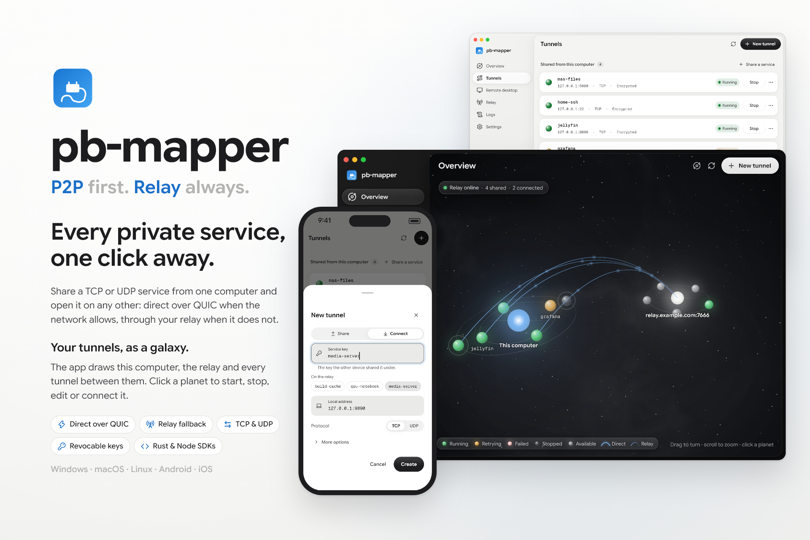

<div align="center">



<h1>pb-mapper</h1>

<p><em>Every private service and every device, one click away.</em></p>

<p>
  <a href="https://www.rust-lang.org/"></a>
  <a href="https://tokio.rs/"></a>
  <a href="https://flutter.dev/"></a>
  <a href="LICENSE"></a>
  <a href="https://github.com/acking-you/pb-mapper/releases"></a>
  <a href="https://crates.io/crates/pb-mapper"></a>
  <a href="https://www.npmjs.com/package/pb-mapper"></a>
  <a href="https://github.com/acking-you/pb-mapper/actions/workflows/release.yml"></a>
  <a href="https://github.com/acking-you/pb-mapper/stargazers"></a>
</p>

<p>
  <a href="README.md"><b>English</b></a> ·
  <a href="README.zh-CN.md">中文</a>
</p>

</div>

---

**pb-mapper** opens what sits behind NAT from wherever you are: a private TCP
or UDP service, or a whole computer with its screen, keyboard and mouse. Run
`register` next to a service and `connect` wherever you need it, and the
service appears on a local port. Each connection picks its own path: a shared
**LAN** first, then a hole-punched **peer-to-peer QUIC path**, and the
**relay** when neither works, before a single application byte is sent.

```text
                 ┌──── direct: UDP hole punching + QUIC ────┐
 your app ─► connect                                         register ─► private service
   :9090         └──── fallback: relay.example.com:7666 ─────┘
```

## What it does

- **Tunnels on the best path** — `register` and `connect` are the whole tunnel
  API, for TCP and UDP alike. LAN detection, hole punching, relay fallback,
  reconnection and recovery after a network change all happen inside them
  ([user guide](docs/user-guide.md)).
- **One port for everything** — `7666/tcp` carries registration, subscription,
  status, administration and relayed bytes for every service, and `7666/udp`
  coordinates hole punching for all of them. Adding a service never opens
  another port.
- **Credentials and namespaces** — one administrator key issues renewable,
  revocable `pbmt1_` credentials, each scoped to its own namespace, so a
  tenant, device or agent session sees only its own services. Expiry and
  revocation take effect on live relay connections at once
  ([authentication](docs/authentication-v2.md)).
- **Status and events** — every tunnel exposes a status stream and an event
  history (direct established, fallback, relay lost, network changed), and
  comes back by itself after relay restarts, outages and network changes
  ([weak-network recovery](docs/weak-network-recovery.md)).
- **Remote desktop** — share a computer from the app, then view and control it
  from another computer or a phone, with hardware H.265/H.264 video and real
  keyboard and mouse. Each session is TLS 1.3 pinned to the host's certificate
  by its invitation, so a relay credential alone can neither watch nor
  control. Windows and macOS computers can be shared
  ([what runs where](#remote-desktop)).
- **One SDK for all of it** — the Rust crate `pb-mapper` carries the tunnels
  and, with its `desktop` feature, the whole remote desktop: a host in a few
  lines, the viewer's encoded video for your own decoder, keyboard, mouse and
  text input, status streams, and `Supervisor`, which carries a viewer through
  stalls and host restarts. The app is built on the same SDK; the Node SDK
  covers tunnels ([Rust](crates/pb-mapper/README.md) · [Node](js/README.md)).
- **An app for every screen** — Windows, macOS, Linux, Android and iOS:
  tunnels on the same paths as the CLI, the relay's services and credentials,
  and the remote desktop ([UI design](docs/ui-design.md)).
- **Fast on either path** — in the author's field tests, direct sessions keep
  interactive latency under **20 ms**, and the relay fallback matches frp's
  one-port-per-mapping setup in latency and stability. How fast your own setup
  is depends on the two networks and where the relay sits.

## How it works

A relay on a public host is the meeting point: `register` publishes a service
to it under a key, and `connect` subscribes to that key and listens on a local
port. A connection goes direct when the relay serves hole punching, the
publisher allows it, the consumer asks for it (all three are the defaults) and
the two networks can actually be punched through; otherwise it uses the relay.
The switch happens **before the publisher opens its local service and before
any application byte is sent**, so nothing is ever replayed and the backend is
dialed exactly once. A network that cannot be punched costs one attempt, not
one per connection: after a fallback the tunnel sends its next connections
straight to the relay for a while (10 s, doubling to 5 min, cleared by a
direct success or a network change).

`--relay-only` on `server`, `register` or `connect` turns direct off on that
side. The other client flags, the LAN transport and port mapping are in
[direct connections](docs/user-guide.md#direct-connections-default); the
relay's `--direct-listen` and `--direct-advertise`, for a UDP port bound or
mapped elsewhere, are under
[Start the central server](docs/user-guide.md#1-start-the-central-server).

Worth knowing:

- **Direct sessions belong to the two endpoints.** A relay restart or a revoked
  credential stops new setups but does not cut a running direct session;
  stopping the local tunnel does. Relayed connections close on revocation at
  once.
- **Not every network can be punched.** Symmetric NATs and blocked UDP use the
  relay. The [design](docs/issue-13-direct-connect-design.zh-CN.md) and the
  [validation record](docs/issue-13-validation.zh-CN.md) describe what has been
  tested.
- **pb-mapper moves bytes.** The service behind a tunnel still owns its own
  authentication and authorization.
- **Credentials are pre-shared, not a public-key identity system.** Direct
  sessions run over QUIC with mutually pinned certificates, and
  `register --codec` adds AES-256-GCM to relayed data. Use TLS or another
  application protocol on top when you need certificate identity or protection
  against traffic analysis ([authentication](docs/authentication-v2.md) ·
  [data encryption](docs/data-encryption-compatibility.md)).

## Get started

**1. Run a relay** on any host with a public IP:

```bash
cargo install pb-mapper-cli --locked   # or a binary from Releases
pb-mapper server                       # relay on 7666/tcp, hole punching on 7666/udp
```

Open **7666/tcp and 7666/udp** in the firewall and security group. On first
start the relay creates a random administrator key, `admin.key`, in its auth
state directory (`/var/lib/pb-mapper/auth` for Linux services).

**2. Issue a credential** for the two ends:

```bash
export MSG_HEADER_KEY="$(sudo cat /var/lib/pb-mapper/auth/admin.key)"
pb-mapper admin --server relay.example.com:7666 key issue --ttl 24h --label laptop
```

**3. Publish a service and reach it**, with the printed `pbmt1_…` credential:

```bash
# next to the service
MSG_HEADER_KEY='pbmt1_…' pb-mapper register tcp --key web --addr 127.0.0.1:8080 --server relay.example.com:7666
# wherever you need it
MSG_HEADER_KEY='pbmt1_…' pb-mapper connect tcp --key web --addr 127.0.0.1:9090 --server relay.example.com:7666
```

`127.0.0.1:9090` now reaches the service. `pb-mapper status sessions` shows
which path each connection took.

Or hand all of it to a coding agent. Tell it:

```text
Fetch and follow instructions from https://raw.githubusercontent.com/acking-you/pb-mapper/master/skills/pb-mapper-suite/INSTALL.md
```

It installs the CLI, deploys the relay, sets up `register` and `connect`, and
verifies the tunnel.

Every command and flag: [user guide](docs/user-guide.md) · the relay in
Docker: [DOCKER_README.md](DOCKER_README.md) · systemd units:
[services/](services/readme.md) · binaries and the app:
[Releases](https://github.com/acking-you/pb-mapper/releases). Coming from 0.7:
direct with relay fallback has been the default since 0.8, and `--relay-only`
keeps the old behavior ([changelog](CHANGELOG.md)).

## Remote desktop

Share a computer's screen and control it from another device, over the relay,
credentials and paths your tunnels already use; the relay needs nothing new.

The aim is that every device can be controlled from any other. Everything
above the operating system (the protocol, the session, QoS, the viewer and
the SDK) is shared; a host adds only its own capture, encoder and input.
Windows was the first and macOS the second; this is what runs where today:

| Role | Where it runs today |
| --- | --- |
| Host | Windows with Media Foundation: GPU H.265 or H.264; the ordinary desktop, or also UAC prompts and the owner's lock screen through the opt-in helper. macOS 12.3 or later, from the app: ScreenCaptureKit into VideoToolbox, after the owner grants Screen Recording and Accessibility (written, not yet run on a Mac) |
| Viewer in the app | Every platform decodes H.265/H.264 natively: Windows and Android (run on hardware and in an Android VM), Linux through GStreamer (run in WSL2 only), macOS and iOS through VideoToolbox (written, not yet built or run); without a decoder the picture is JPEG, up to 8 FPS |
| Viewer in the SDK | Any OS, with the decoder you bring |

**In the app:** on the computer to share, open **Remote desktop** and choose
**Turn on remote control** (or **Share the ordinary desktop only**, without
the helper) on Windows, or **Share this computer** on a Mac, after allowing
what the card asks for. Copy the `pbd1.` invitation privately, or
show its QR code to a phone: whoever holds it can view, and control is a
separate permission the host grants. On the other device, choose **Add
computer** (**Scan to add** or **Paste invitation** on a phone) and
**Connect**. The viewer's **Display** menu (on a phone, **More**) sets the
resolution, maximum frame rate and codec, turns on the quality monitor (speed,
frame rate, delay, bitrate, codec, resolution), and, while a desktop controls
a Windows or Mac computer, changes that computer's resolution to **Fit
local**. **Shortcuts → Input method** chooses whether your own input method
composes or the remote computer's, and the pointer takes the remote
computer's shape.

**In your own app:** `pb-mapper = { version = "0.11", features = ["desktop"] }`
gives you the host, the viewer's encoded picture for your own decoder, input,
status streams (`Host::watch`, `Viewer::watch`), `supervisor::Supervisor` to
keep a viewer connected, and `trust::TrustFile` to keep a host's invitation
valid across restarts. `cargo run -p pb-mapper --features desktop --example
desktop_loopback` runs a relay, a host and a viewer in one process on any OS.
The API and how to decode are in the SDK's
[Remote desktop section](crates/pb-mapper/README.md#remote-desktop); the
helper, the video pipeline and measurements are in
[docs/remote-desktop.md](docs/remote-desktop.md).

Not yet: hosts on Linux or phones, a Mac's lock screen, audio, clipboard,
file transfer, and more than one viewer at a time. The hosts are the way to
every device: each is one backend behind a seam that already exists, and
[Platforms](docs/remote-desktop.md#platforms) is the guide to writing the
ones for Linux and Android. The helper's acceptance for UAC prompts
under Windows' default secure-desktop policy, and for password entry on a
locked screen, is still outstanding.

## SDKs

The CLI, the app and the Node package all run the same Rust client. In your
own program:

```toml
[dependencies]
pb-mapper = "0.11"
tokio = { version = "1", features = ["full"] }
```

```rust
use pb_mapper::{Client, ClientConfig, ConnectRequest, RegisterRequest, Transport};

let client = Client::new(ClientConfig {
    server: "relay.example.com:7666".into(),
    credential: std::env::var("MSG_HEADER_KEY")?,
    keep_alive: true,
    namespace: None,
})?;

// Device side: publish a local service.
let registration = client.register(RegisterRequest {
    key: "web".into(),
    local_addr: "127.0.0.1:8080".into(),
    transport: Transport::Tcp,
    codec: false,
    force_namespace: false,
}).await?;
registration.wait_ready().await?;

// Anywhere else: reach it on a local port, direct first.
let connection = client.connect(ConnectRequest {
    key: "web".into(),
    local_addr: "127.0.0.1:9090".into(),
    transport: Transport::Tcp,
}).await?;
connection.wait_ready().await?;
```

`cargo run -p pb-mapper --example quickstart` runs a relay in-process, so it
needs no setup. Every example and the whole API are in the
[Rust SDK](crates/pb-mapper/README.md), and the remote desktop in your own app
is [its own section](crates/pb-mapper/README.md#remote-desktop) there. Build
without the `p2p` feature (`default-features = false`) for a relay-only client
without QUIC.

- **Node and Bun** — `npm install pb-mapper`, prebuilt for Linux (x64, arm64,
  glibc), macOS (x64, arm64) and Windows x64, on Node.js 18+ and Bun 1.1+
  ([Node SDK](js/README.md)).
- **CLI** — `server`, `register`, `connect`, `status` and `admin` in one
  `pb-mapper` binary ([user guide](docs/user-guide.md)).
- **Agent Skill** — installs and verifies a relay, `register` and `connect`
  end to end ([skill](skills/pb-mapper-suite/SKILL.md)).
- **Relay as a library** — `pb-mapper-server` embeds a relay in your own
  process ([crate](crates/pb-mapper-server/README.md)).

## Documentation

| | |
| --- | --- |
| **Use** | [User guide](docs/user-guide.md) · [Docker](DOCKER_README.md) · [systemd](services/readme.md) · [Agent Skill](skills/pb-mapper-suite/SKILL.md) · [Changelog](CHANGELOG.md) |
| **SDKs** | [Rust](crates/pb-mapper/README.md) · [Node](js/README.md) · [Examples](crates/pb-mapper/examples) |
| **Remote desktop** | [Guide and design](docs/remote-desktop.md) · [Platforms](docs/remote-desktop.md#platforms) · [Validation records](docs/validation) |
| **Paths and recovery** | [Direct connections](docs/issue-13-direct-connect-design.zh-CN.md) (Chinese) · [NAT validation](docs/nat-traversal-validation.zh-CN.md) (Chinese) · [QUIC relay](docs/relay-quic.zh-CN.md) (Chinese) · [Weak-network recovery](docs/weak-network-recovery.md) · [UDP forwarding](docs/udp-datagram-forwarding.md) |
| **Security** | [Authentication and protocol v2](docs/authentication-v2.md) · [Data encryption](docs/data-encryption-compatibility.md) |
| **App** | [UI design](docs/ui-design.md) · [Updates](docs/ui-updates.md) · [Building it](ui/README.md) |

All pages: [docs index](docs/README.md).

## Development

`crates/` holds the Rust workspace (core, auth, protocol, server, client,
remote desktop, the `pb-mapper` SDK facade, the Node-API binding, the CLI and
the testkit), `js/` the npm package, `ui/` the Flutter app and its C ABI,
`skills/` the agent workflows, and `docker/`, `services/` and `scripts/`
packaging and operations. The rules a change must keep are in
[AGENTS.md](AGENTS.md).

```bash
make build-pb-mapper
cargo test --workspace --all-features
```

## License

[MIT](LICENSE)
