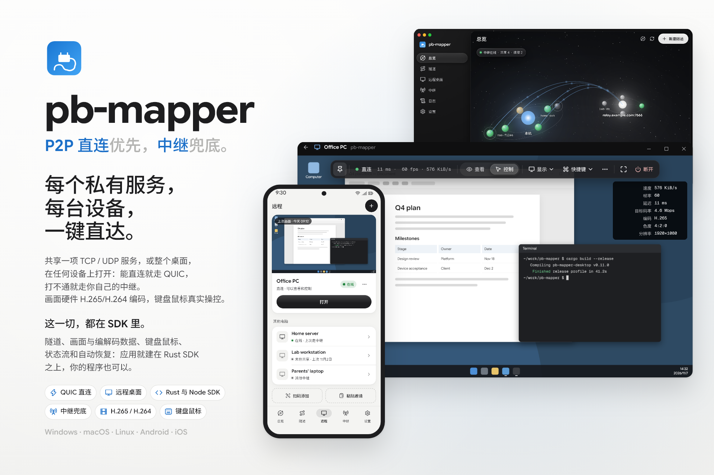

<div align="center">



<h1>pb-mapper</h1>

<p><em>每个私有服务、每台设备，一键直达。</em></p>

<p>
  <a href="https://www.rust-lang.org/"></a>
  <a href="https://tokio.rs/"></a>
  <a href="https://flutter.dev/"></a>
  <a href="LICENSE"></a>
  <a href="https://github.com/acking-you/pb-mapper/releases"></a>
  <a href="https://crates.io/crates/pb-mapper"></a>
  <a href="https://www.npmjs.com/package/pb-mapper"></a>
  <a href="https://github.com/acking-you/pb-mapper/actions/workflows/release.yml"></a>
  <a href="https://github.com/acking-you/pb-mapper/stargazers"></a>
</p>

<p>
  <a href="README.md">English</a> ·
  <a href="README.zh-CN.md"><b>中文</b></a>
</p>

</div>

---

**pb-mapper** 让你在任何地方打开 NAT 后面的东西：一项私有的 TCP / UDP 服务，或者一整台电脑，连同它的屏幕、键盘和鼠标。在服务旁边运行 `register`，在需要用它的地方运行 `connect`，服务就出现在本地端口上。每条连接自己选路：先走共同的**局域网**，再走 UDP 打洞的 **P2P QUIC 直连**，都走不通就在发送任何业务字节之前改走**中继**。

```text
                 ┌──── 直连：UDP 打洞 + QUIC ────────────────┐
 你的应用 ─► connect                                          register ─► 私有服务
   :9090         └──── 回退：relay.example.com:7666 ──────────┘
```

## 能做什么

- **走最好的路的隧道**：`register` 和 `connect` 就是隧道的全部 API，TCP 和 UDP 一视同仁；局域网发现、打洞、中继回退、断线重连、网络切换后的恢复都在里面自动完成（[使用手册](docs/user-guide.zh-CN.md)）。
- **一个端口承载一切**：`7666/tcp` 承载所有服务的注册、订阅、状态查询、管理和中继数据，`7666/udp` 为所有服务协调打洞；新增服务不用再开任何端口。
- **凭据与命名空间**：一把管理员密钥签发可续期、可吊销的 `pbmt1_` 临时凭据，每把凭据拥有独立命名空间，租户、设备或 agent 会话只能看到自己的服务；过期与吊销会立即作用于现有中继连接（[认证体系](docs/authentication-v2.zh-CN.md)）。
- **状态与事件**：每条隧道都提供状态流和事件历史（直连建立、回退中继、中继断开、网络切换），并在中继重启、断网和网络切换后自动恢复（[弱网恢复](docs/weak-network-recovery.md)）。
- **远程桌面**：在应用里共享一台电脑，就能从另一台电脑或手机上查看并操控它，画面由硬件 H.265/H.264 编码，键鼠是真实输入。每个会话都是 TLS 1.3，邀请里固定了主机证书，单凭中继凭据既看不到画面也控制不了。Windows 是第一种可以被共享的电脑（[各平台支持情况](#远程桌面)）。
- **一套 SDK 全部搞定**：Rust crate `pb-mapper` 承载隧道；开启 `desktop` feature 后还包含完整的远程桌面：几行代码起一个主机，查看端的编码视频交给你自己的解码器，键盘、鼠标与文本输入，状态流，以及带着查看端熬过卡顿和主机重启的 `Supervisor`。应用本身就基于这套 SDK；Node SDK 覆盖隧道部分（[Rust](crates/pb-mapper/README.md) · [Node](js/README.md)）。
- **每块屏幕上的应用**：Windows、macOS、Linux、Android 与 iOS：隧道与 CLI 走同样的路径，还能管理中继上的服务与凭据，并使用远程桌面（[UI 设计](docs/ui-design.md)）。
- **两条路都快**：作者实测，P2P 直连可以把交互延迟压到 **20 ms 以内**；回退到中继时，延迟和稳定性与 frp「一个端口对应一段映射」的模式持平。实际表现取决于两端网络和中继所在位置。

## 工作原理

公网机器上的 relay 是汇合点：`register` 用一个 key 把服务发布到它上面，`connect` 订阅这个 key 并在本地端口监听。relay 提供打洞、提供端允许直连、消费端请求直连（这三项都是默认值），并且两端网络确实能打通时，连接走直连；否则走中继。切换发生在**提供端打开本地服务之前、任何业务字节发送之前**，因此不会重放任何数据，后端也只会被拨号一次。打不通的网络只付出一次尝试的代价，而不是每条连接都等一次：回退之后，这条隧道接下来的连接会直接走中继一段时间（10 秒起，翻倍增长到 5 分钟；直连成功或网络切换时清零）。

给 `server`、`register` 或 `connect` 加上 `--relay-only` 就在那一侧关闭直连。其余客户端参数、局域网传输和端口映射见[直连](docs/user-guide.zh-CN.md#直连默认)；relay 的 `--direct-listen` 与 `--direct-advertise`（UDP 端口绑定或映射到别处时使用）见[启动中心服务器](docs/user-guide.zh-CN.md#1启动中心服务器)。

需要了解的边界：

- **直连会话归两端所有。** relay 重启或凭据吊销只阻止新的建连，不会切断已建立的直连；停止本地隧道才会关闭它。中继连接则在吊销时立即关闭。
- **并非所有网络都能打通。** 对称 NAT、UDP 被封锁等情况走中继。已测试的场景见[设计说明](docs/issue-13-direct-connect-design.zh-CN.md)与[验收记录](docs/issue-13-validation.zh-CN.md)。
- **pb-mapper 只负责传输字节。** 隧道后面的服务仍然负责自己的认证与授权。
- **凭据是预共享的，不是公钥身份体系。** 直连会话运行在 QUIC 上，双方证书互相固定；`register --codec` 为中继数据增加 AES-256-GCM 加密。如需证书身份或对流量分析的防护，请在其上叠加 TLS 或其他应用协议（[认证设计](docs/authentication-v2.zh-CN.md) · [数据加密兼容性](docs/data-encryption-compatibility.md)）。

## 快速开始

**1. 在有公网 IP 的机器上运行 relay：**

```bash
cargo install pb-mapper-cli --locked   # 或从 Releases 下载二进制
pb-mapper server                       # 7666/tcp 中继，7666/udp 打洞
```

在防火墙和云安全组放行 **7666/tcp 和 7666/udp**。首次启动时 relay 会在认证状态目录生成随机管理员密钥 `admin.key`（Linux 系统服务为 `/var/lib/pb-mapper/auth`）。

**2. 为两端签发凭据：**

```bash
export MSG_HEADER_KEY="$(sudo cat /var/lib/pb-mapper/auth/admin.key)"
pb-mapper admin --server relay.example.com:7666 key issue --ttl 24h --label laptop
```

**3. 用打印出的 `pbmt1_…` 凭据发布服务并访问它：**

```bash
# 服务所在机器
MSG_HEADER_KEY='pbmt1_…' pb-mapper register tcp --key web --addr 127.0.0.1:8080 --server relay.example.com:7666
# 需要访问的机器
MSG_HEADER_KEY='pbmt1_…' pb-mapper connect tcp --key web --addr 127.0.0.1:9090 --server relay.example.com:7666
```

现在访问 `127.0.0.1:9090` 就是访问那项服务。`pb-mapper status sessions` 可以查看每条连接走的是哪条路径。

也可以把这一切交给编码 agent，直接告诉它：

```text
Fetch and follow instructions from https://raw.githubusercontent.com/acking-you/pb-mapper/master/skills/pb-mapper-suite/INSTALL.md
```

它会安装 CLI、部署 relay、配置 register/connect 并完成验收。

所有命令与参数见[使用手册](docs/user-guide.zh-CN.md)；用 Docker 运行 relay 见 [DOCKER_README.md](DOCKER_README.md)（英文）；systemd unit 见 [services/](services/readme.md)；预编译二进制与应用见 [Releases](https://github.com/acking-you/pb-mapper/releases)。从 0.7 升级：0.8 起默认「直连优先、中继兜底」，加 `--relay-only` 即可保持原有行为（[更新日志](CHANGELOG.md)）。

## 远程桌面

共享一台电脑的屏幕，并从另一台设备操控它，用的是隧道已有的中继、凭据和路径；中继不需要任何新东西。

目标是让每台设备都能被任何一台设备操控。操作系统之上的一切（协议、会话、QoS、查看端和 SDK）都是共用的，一种主机只需要补上自己的采集、编码和输入。Windows 是第一种，目前各平台的支持情况如下：

| 角色 | 目前支持 |
| --- | --- |
| 主机 | 装有 Media Foundation 的 Windows：GPU H.265 或 H.264；普通桌面，或经可选的辅助服务连同 UAC 提示和本人的锁屏 |
| 应用里的查看端 | Windows 与 Android 原生解码 H.265/H.264；macOS、Linux 和 iOS（尚未验证）以 JPEG 显示画面，最高 8 FPS |
| SDK 里的查看端 | 任何系统，解码器由你提供 |

**在应用里**：在要共享的电脑上（目前是 Windows）打开**远程桌面**，选择**开启远程控制**（或**只共享普通桌面**，不安装辅助服务）。私下复制 `pbd1.` 邀请，或把二维码给手机扫：持有邀请的人都能查看，操控是主机另外授予的权限。在另一台设备上选择**添加电脑**（手机上是**扫码添加**或**粘贴邀请**），再点**连接**。查看器的**显示**菜单（手机上在**更多**里）可以设置分辨率、最高帧率和编解码器，打开质量监测（速度、帧率、延迟、码率、编解码器、分辨率），在桌面端操控 Windows 电脑时，还能把对方的分辨率改成**适配本机**。

**在你自己的应用里：** `pb-mapper = { version = "0.11", features = ["desktop"] }` 提供主机、交给你自己解码器的编码画面、输入、状态流（`Host::watch`、`Viewer::watch`）、让查看端保持连接的 `supervisor::Supervisor`，以及让主机的邀请在重启后依然有效的 `trust::TrustFile`。`cargo run -p pb-mapper --features desktop --example desktop_loopback` 在任意系统上于一个进程内跑起 relay、主机和查看端。API 与解码方法见 SDK 的 [Remote desktop 一节](crates/pb-mapper/README.md#remote-desktop)，辅助服务、视频管线与实测数据见 [docs/remote-desktop.md](docs/remote-desktop.md)（英文）。

暂不支持：Linux、macOS 或手机作主机、音频、剪贴板、文件传输，以及同时多个查看端。补齐主机正是通向「每台设备」的路：每种主机只是接在现有接口后面的一个后端，[Platforms](docs/remote-desktop.md#platforms)（英文）一节就是给 Linux、macOS 和 Android 写后端的指南。辅助服务在 Windows 默认安全桌面策略下的 UAC 验收，以及锁屏时输入密码的验收，都还未完成。

## SDK

CLI、应用和 Node 包跑的是同一个 Rust 客户端。在你自己的程序里：

```toml
[dependencies]
pb-mapper = "0.11"
tokio = { version = "1", features = ["full"] }
```

```rust
use pb_mapper::{Client, ClientConfig, ConnectRequest, RegisterRequest, Transport};

let client = Client::new(ClientConfig {
    server: "relay.example.com:7666".into(),
    credential: std::env::var("MSG_HEADER_KEY")?,
    keep_alive: true,
    namespace: None,
})?;

// 设备端：发布本地服务
let registration = client.register(RegisterRequest {
    key: "web".into(),
    local_addr: "127.0.0.1:8080".into(),
    transport: Transport::Tcp,
    codec: false,
    force_namespace: false,
}).await?;
registration.wait_ready().await?;

// 任意位置：在本地端口访问它，直连优先
let connection = client.connect(ConnectRequest {
    key: "web".into(),
    local_addr: "127.0.0.1:9090".into(),
    transport: Transport::Tcp,
}).await?;
connection.wait_ready().await?;
```

`cargo run -p pb-mapper --example quickstart` 会在进程内跑起一个 relay，无需任何准备。全部示例与完整 API 见 [Rust SDK](crates/pb-mapper/README.md)（英文），在自己的应用里使用远程桌面见其中的 [Remote desktop 一节](crates/pb-mapper/README.md#remote-desktop)。关闭 `p2p` feature（`default-features = false`）可得到不含 QUIC 的纯中继客户端。

- **Node 与 Bun**：`npm install pb-mapper`，预编译覆盖 Linux（x64、arm64，glibc）、macOS（x64、arm64）与 Windows x64，支持 Node.js 18+ 与 Bun 1.1+（[Node SDK](js/README.md)）。
- **CLI**：一个 `pb-mapper` 二进制包含 `server`、`register`、`connect`、`status`、`admin`（[使用手册](docs/user-guide.zh-CN.md)）。
- **Agent Skill**：端到端安装并验收 relay、register 与 connect（[skill](skills/pb-mapper-suite/SKILL.md)）。
- **Relay 库**：`pb-mapper-server` 可把 relay 内嵌进自己的进程（[crate](crates/pb-mapper-server/README.md)）。

## 文档

| | |
| --- | --- |
| **使用** | [使用手册](docs/user-guide.zh-CN.md) · [Docker](DOCKER_README.md) · [systemd](services/readme.md) · [Agent Skill](skills/pb-mapper-suite/SKILL.md) · [更新日志](CHANGELOG.md) |
| **SDK** | [Rust](crates/pb-mapper/README.md) · [Node](js/README.md) · [示例](crates/pb-mapper/examples) |
| **远程桌面** | [使用与设计](docs/remote-desktop.md) · [各平台](docs/remote-desktop.md#platforms) · [验收记录](docs/validation) |
| **路径与恢复** | [直连设计](docs/issue-13-direct-connect-design.zh-CN.md) · [多层 NAT 验收](docs/nat-traversal-validation.zh-CN.md) · [QUIC 中继](docs/relay-quic.zh-CN.md) · [弱网恢复](docs/weak-network-recovery.md) · [UDP 转发](docs/udp-datagram-forwarding.md) |
| **安全** | [认证与 V2 协议](docs/authentication-v2.zh-CN.md) · [数据加密兼容性](docs/data-encryption-compatibility.md) |
| **应用** | [UI 设计](docs/ui-design.md) · [应用更新](docs/ui-updates.md) · [构建](ui/README.md) |

全部文档：[文档索引](docs/README.md)（英文）。

## 开发

`crates/` 是 Rust workspace（core、auth、protocol、server、client、远程桌面、`pb-mapper` SDK 门面、Node-API 绑定、CLI 与 testkit），`js/` 是 npm 包，`ui/` 是 Flutter 应用及其 C ABI，`skills/` 是 agent 工作流，`docker/`、`services/`、`scripts/` 是打包与运维工具。改动必须遵守的规则见 [AGENTS.md](AGENTS.md)。

```bash
make build-pb-mapper
cargo test --workspace --all-features
```

## 许可证

[MIT](LICENSE)
