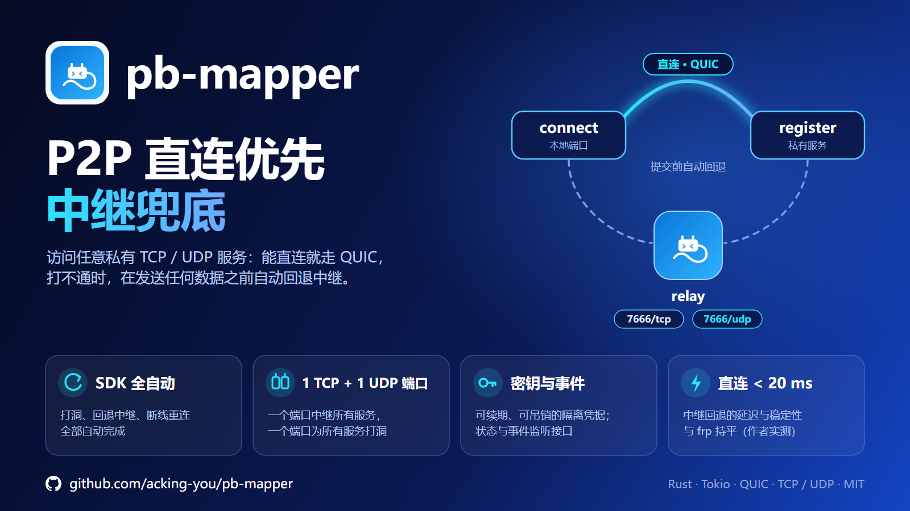

<div align="center">



<p>
  <a href="https://www.rust-lang.org/"></a>
  <a href="https://tokio.rs/"></a>
  <a href="https://flutter.dev/"></a>
  <a href="LICENSE"></a>
  <a href="https://github.com/acking-you/pb-mapper/releases"></a>
  <a href="https://crates.io/crates/pb-mapper"></a>
  <a href="https://www.npmjs.com/package/pb-mapper"></a>
  <a href="https://github.com/acking-you/pb-mapper/actions/workflows/release.yml"></a>
  <a href="https://github.com/acking-you/pb-mapper/stargazers"></a>
</p>

<p>
  <a href="README.md">English</a> ·
  <a href="README.zh-CN.md"><b>中文</b></a>
</p>

</div>

---

**pb-mapper** 用来访问 NAT 后面的私有 TCP / UDP 服务。在服务旁边运行 `register`，在需要用它的地方运行 `connect`，服务就出现在本地端口上。每条连接都**先尝试 P2P QUIC 直连**；网络打不通时，在发送任何业务字节之前**自动回退到中继**。路径不需要手动选：CLI 和 SDK 按连接自动决定，并在中继重启、断网和网络切换时自动维持隧道。

```text
                 ┌──── 直连：UDP 打洞 + QUIC ────────────────┐
 你的应用 ─► connect                                          register ─► 私有服务
   :9090         └──── 回退：relay.example.com:7666 ──────────┘
```

## 为什么选 pb-mapper

**🧩 SDK 把网络问题全包了。** `register` 和 `connect` 就是全部 API。打洞、双向认证 QUIC、中继回退、断线重连、DNS 刷新、网络切换后的恢复都在里面自动完成，TCP 和 UDP 一视同仁。一个进程可以同时维护任意多条隧道，每个 Client 各用各的凭据。

**🔌 一个 TCP 端口承载全部中继，一个 UDP 端口让所有服务自由打洞。** `7666/tcp` 承载所有服务的注册、订阅、状态查询、管理和中继数据；`7666/udp` 为所有服务协调打洞。新增服务不用再开任何端口。

**🔑 自带密钥管理、隔离和事件监听。** 一把管理员密钥签发可续期、可吊销的 `pbmt1_` 临时凭据，每把凭据拥有独立命名空间，租户、设备或 agent 会话只能看到自己的服务。每条隧道都提供状态流和事件历史（直连建立、回退中继、中继断开、网络切换），接入任何 App 都很直接，agent harness 的 remote control 正是它的主场景。

**⚡ 两条路都快。** 作者实测：P2P 直连可以把交互延迟压到 **20 ms 以内**；回退到中继时，延迟和稳定性与 frp「一个端口对应一段映射」的模式持平。实际表现取决于两端网络和中继所在位置。

## 快速开始

**1. 在有公网 IP 的机器上运行 relay：**

```bash
cargo install pb-mapper-cli --locked   # 或从 Releases 下载二进制
pb-mapper server                       # 7666/tcp 中继，7666/udp 打洞
```

在防火墙和云安全组放行 **7666/tcp 和 7666/udp**。首次启动时 relay 会在认证状态目录生成随机管理员密钥 `admin.key`（Linux 系统服务为 `/var/lib/pb-mapper/auth`）。

**2. 为两端签发凭据：**

```bash
export MSG_HEADER_KEY="$(sudo cat /var/lib/pb-mapper/auth/admin.key)"
pb-mapper admin --server relay.example.com:7666 key issue --ttl 24h --label laptop
```

**3. 用打印出的 `pbmt1_…` 凭据发布服务并访问它：**

```bash
# 服务所在机器
MSG_HEADER_KEY='pbmt1_…' pb-mapper register tcp --key web --addr 127.0.0.1:8080 --server relay.example.com:7666
# 需要访问的机器
MSG_HEADER_KEY='pbmt1_…' pb-mapper connect tcp --key web --addr 127.0.0.1:9090 --server relay.example.com:7666
```

现在访问 `127.0.0.1:9090` 就是访问那项服务。`pb-mapper status sessions` 可以查看每条连接走的是哪条路径。

## 连接如何选择路径

以下条件全部满足时走直连，前三条都是默认值：

1. relay 提供打洞服务（默认开启，使用与 TCP 相同的端口号）；
2. 提供端允许直连（`register` 默认允许）；
3. 消费端请求直连（`connect` 默认 `--path auto`）；
4. 两端网络确实能打通。

任一条件不满足就走中继。切换发生在**提供端打开本地服务之前、任何业务字节发送之前**，因此不会重放任何数据，后端也只会被拨号一次。回退之后，这条隧道接下来的连接会直接走中继一段时间（10 秒起，翻倍增长到 5 分钟；直连成功或网络切换时清零），所以打不通的网络只付出一次尝试的代价，而不是每条连接都等一次。

需要时可以在任意一侧关闭直连：

| 位置 | 参数 | 效果 |
| --- | --- | --- |
| Relay | `pb-mapper server --relay-only` | 不开 UDP 端口，所有连接走中继 |
| 提供端 | `pb-mapper register --relay-only …` | 这项服务只能经中继访问 |
| 消费端 | `pb-mapper connect --relay-only …` | 这条隧道始终走中继 |

relay 只公布 UDP 端口号，客户端把它和自己拨通 relay 时用的地址配对，所以 1:1 NAT、端口转发都不用额外配置。如果 UDP 端口被映射到别处，用 `--direct-advertise 公网IP:端口` 指定；用 `--direct-listen` 绑定其他本地地址。

需要了解的边界：

- **直连会话归两端所有。** relay 重启或凭据吊销只阻止新的建连，不会切断已建立的直连；停止本地隧道才会关闭它。中继连接则在吊销时立即关闭。
- **并非所有网络都能打通。** 对称 NAT、UDP 被封锁等情况走中继。已测试的场景见[设计说明](docs/issue-13-direct-connect-design.zh-CN.md)与[验收记录](docs/issue-13-validation.zh-CN.md)。
- **pb-mapper 只负责传输字节。** 隧道后面的服务仍然负责自己的认证与授权。

## SDK

### Rust

```toml
[dependencies]
pb-mapper = "0.8"
tokio = { version = "1", features = ["full"] }
```

```rust
use pb_mapper::{Client, ClientConfig, ConnectRequest, RegisterRequest, Transport};

let client = Client::new(ClientConfig {
    server: "relay.example.com:7666".into(),
    credential: std::env::var("MSG_HEADER_KEY")?,
    keep_alive: true,
    namespace: None,
})?;

// 设备端：发布本地服务
let registration = client.register(RegisterRequest {
    key: "web".into(),
    local_addr: "127.0.0.1:8080".into(),
    transport: Transport::Tcp,
    codec: false,
    force_namespace: false,
}).await?;
registration.wait_ready().await?;

// 任意位置：在本地端口访问它，直连优先
let connection = client.connect(ConnectRequest {
    key: "web".into(),
    local_addr: "127.0.0.1:9090".into(),
    transport: Transport::Tcp,
}).await?;
connection.wait_ready().await?;

// 监听状态变化：Starting → Connected → Retrying → …
let mut status = connection.subscribe();
while status.changed().await.is_ok() {
    println!("{:?}", *status.borrow());
}
```

每项能力都有可运行的示例，见 [`crates/pb-mapper/examples/`](crates/pb-mapper/examples)。建议从 `cargo run -p pb-mapper --example quickstart` 开始，它不需要你自己的 relay：

| 示例 | 内容 |
| --- | --- |
| [`quickstart`](crates/pb-mapper/examples/quickstart.rs) | 内嵌 relay、发布 echo 服务、直连往返，并打印实际路径 |
| [`register_tcp`](crates/pb-mapper/examples/register_tcp.rs) / [`connect_tcp`](crates/pb-mapper/examples/connect_tcp.rs) | TCP 隧道两端，实时显示直连与中继的连接数 |
| [`udp`](crates/pb-mapper/examples/udp.rs) | UDP 隧道两端，例如游戏服务器 |
| [`path_options`](crates/pb-mapper/examples/path_options.rs) | `allow_direct: false`、`PathPolicy::RelayOnly`、空闲超时 |
| [`watch_events`](crates/pb-mapper/examples/watch_events.rs) | 状态流、事件历史、直连实时阶段、JSON 诊断 |
| [`status`](crates/pb-mapper/examples/status.rs) | 命名空间内的服务、控制连接与会话 |
| [`admin_credentials`](crates/pb-mapper/examples/admin_credentials.rs) | 签发、查看、显示密钥、续期、列出、吊销、回收凭据 |
| [`admin_inventory`](crates/pb-mapper/examples/admin_inventory.rs) | 所有租户的服务与连接、清理卡住的连接、轮换根密钥 |
| [`remote_control`](crates/pb-mapper/examples/remote_control.rs) | agent harness 模式：每个会话一把凭据、相互隔离、结束时吊销 |

关闭 `p2p` feature（`default-features = false`）可得到不含 QUIC 的纯中继客户端。

### TypeScript（Node-API）

```bash
npm install pb-mapper
```

```ts
import { Client } from "pb-mapper";

const client = new Client({
  server: "relay.example.com:7666",
  credential: process.env.MSG_HEADER_KEY!,
});

const conn = await client.connect({
  key: "web", localAddr: "127.0.0.1:9090", transport: "tcp",
});
await conn.waitReady();

// 事件监听：每次变化 resolve 一次，隧道终止后循环结束
for (let s = conn.status(); s !== "stopped" && !s.startsWith("failed");) {
  s = await conn.nextStatus();
  console.log(s, conn.diagnostics().events.at(-1));
}
```

预编译覆盖 Linux（x64、arm64，glibc）、macOS（x64、arm64）与 Windows x64，支持 Node.js 18+ 与 Bun 1.1+。完整 API 见 [`js/README.md`](js/README.md)。

### 其他接入面

| 接入面 | 能力 |
| --- | --- |
| CLI `pb-mapper` | 一个二进制包含 `server`、`register`、`connect`、`status`、`admin` |
| Agent Skill | 端到端安装并验收 relay、register 与 connect（见下文） |
| Flutter UI | 基于 C ABI 的桌面与移动端 GUI，目前走中继路径 |
| Relay 库 | `pb-mapper-server`，可把 relay 内嵌进自己的进程 |

## 凭据与安全

| 凭据 | 持有者 | 权限 |
| --- | --- | --- |
| 管理员密钥（32 字节） | Relay 运维者或可信的凭据分发自动化 | 签发、查看、续期、吊销、轮换；检查所有命名空间 |
| 临时 `pbmt1_` 凭据 | 单个租户、设备、harness 或会话 | 只能在自己的命名空间内注册、连接和查询 |

- 临时凭据由管理员密钥、持久化的 relay 实例 ID 和 key ID 派生，relay 只保存生命周期元数据，不保存密钥本身。过期、吊销与根密钥轮换会立即作用于现有中继连接。
- V2 协议在加密的首个请求内完成认证，不额外增加往返。直连会话运行在 QUIC 上，双方证书互相固定并绑定到会话授权。`register --codec` 为中继数据增加 AES-256-GCM 加密。
- 凭据是预共享的，不是公钥身份体系。如需证书身份或对流量分析的防护，请在其上叠加 TLS 或其他应用协议。详见[认证设计](docs/authentication-v2.zh-CN.md)与[数据加密兼容性](docs/data-encryption-compatibility.md)。

## 部署

- **Agent Skill**：直接告诉你的编码 agent
  `Fetch and follow instructions from https://raw.githubusercontent.com/acking-you/pb-mapper/master/skills/pb-mapper-suite/INSTALL.md`，
  它会安装 CLI、部署 relay、配置 register/connect 并完成验收。
- **Docker**：`docker compose -f docker/docker-compose.yml up -d` 同时发布 `7666/tcp` 与 `7666/udp`，见 [`DOCKER_README.md`](DOCKER_README.md)。
- **systemd**：relay、register、connect 的 unit 文件在 [`services/`](services/readme.md)。
- **预编译二进制**：Linux、macOS、Windows 的 CLI 与 UI 见 [Releases](https://github.com/acking-you/pb-mapper/releases)。

## 从 0.7 升级

现在所有位置的默认值都是「直连优先、中继兜底」。原有命令继续可用：`--enable-direct`、`--allow-direct`、`--path auto` 仍然被接受，连接旧版 relay 的客户端会直接走中继。想保持 0.7 的行为，就给 `server`、`register` 或 `connect` 加上 `--relay-only`。SDK 中，Node 设 `allowDirect: false` / `path: "relay-only"`，Rust 用 `RegisterOptions { allow_direct: false, .. }` / `PathPolicy::RelayOnly`。0.7 客户端不会把公布的端口号与 relay 地址配对，因此即使开启了直连，连接默认配置的 0.8 relay 也会回退中继；升级客户端，或用 `--direct-advertise 公网IP:7666` 启动 relay 即可。

## 文档

- [使用手册](docs/user-guide.zh-CN.md)：所有命令与参数
- [弱网恢复](docs/weak-network-recovery.md)：超时、资源边界与故障测试
- [认证与 V2 协议](docs/authentication-v2.zh-CN.md)
- [直连设计说明](docs/issue-13-direct-connect-design.zh-CN.md)
- [更新日志](CHANGELOG.md)

仓库结构：`crates/` 是 Rust workspace（core、auth、protocol、server、client、`pb-mapper` SDK 门面、Node-API 绑定、CLI 与 testkit）；`js/` 是 npm 包；`ui/` 是 Flutter 应用及其 C ABI；`skills/` 是 agent 工作流；`docker/`、`services/`、`scripts/` 是打包与运维工具。

```bash
make build-pb-mapper
cargo test --workspace --all-features
```

## 许可证

[MIT](LICENSE)
