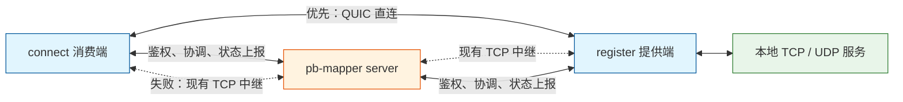
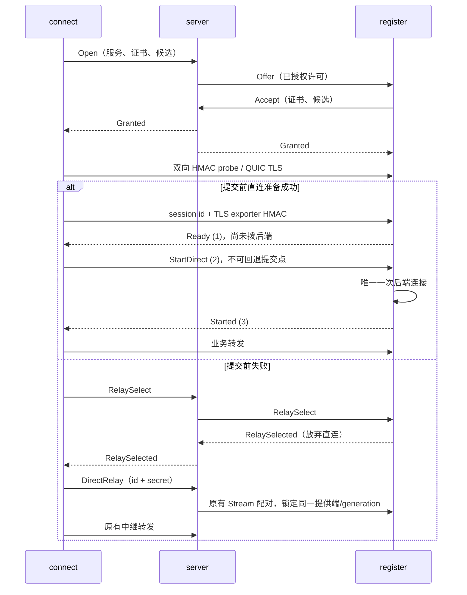

# Issue #13：直连优先、失败中继的设计与实施方案

> **0.8.0 起直连默认开启。** relay 在与 TCP 相同的端口号上监听 UDP，`register` 默认允许直连，`connect` 默认 `--path auto`；任一侧加 `--relay-only` 即恢复原有中继协议，0.7 的 `--enable-direct`、`--allow-direct`、`--path auto` 仍然可用。`--direct-advertise` 可以省略：relay 只公布端口号，客户端用自己拨通 relay 的地址与之配对。消费端在提交前回退后会暂停直连一段时间（10 秒起翻倍到 5 分钟，直连成功或网络切换时清零）。下文记录的是 0.7.0 的初始设计，其中“默认仅中继”“必须显式开启”等描述以本段为准。

采用 **pb-mapper 自主协调 + 现有 TCP 控制面 + STUN/UDP 探测 + Quinn QUIC 直连 + 现有 TCP 中继兜底**。服务端开启直连支持且对应 UDP 探测端口就绪后，客户端每次 `connect` 可选择直连优先或仅中继；默认仅中继，保持现有协议和控制方式。server 完成建连授权、候选地址交换和状态汇总；直连建立后，由两端客户端持有和关闭会话。

这份方案按 2026-10-23 的讨论收敛：用户最新要求覆盖 [issue #13](https://github.com/acking-you/pb-mapper/issues/13) 中原有的“服务端请求关闭直连”要求。本次已实现服务端开关、逐次 connect 策略、打洞直连、提交前中继兜底，以及只读会话观测。CLI、Rust SDK 和 Node API 接入了这些能力；现有 C ABI/Flutter 继续使用默认中继入口。Rust 工具链/SDK 最低版本/CI 升级到 1.99.1。下文第 4 节起描述实际实现，验收证据见 [测试记录](issue-13-validation.zh-CN.md)。

代码分析基线：pb-mapper [`672613c6`](https://github.com/acking-you/pb-mapper/tree/672613c6a56eff982d4f8f1e2bd1b465d7c74738)，Tailscale [`f8ad538a`](https://github.com/tailscale/tailscale/tree/f8ad538a3ba0b905c87688c3bc881d20e232a644)。其他参考版本与 fork 维护方式见 [依赖说明](../deps/README.md)。

## 1. 责任边界与现有代码的落点



一次 `connect`/`register` 调用形成一个本地 tunnel 句柄；其中每条 TCP 连接或 UDP 逻辑流是一个业务会话。控制连接、注册 worker、业务会话必须分别建模。

| 责任 | server | 两端客户端 |
|---|---|---|
| 新会话 | 检查凭据、namespace、服务权限，选择提供端，下发一次建连许可 | 提交能力和候选地址，验证对端身份 |
| 建连路径 | 转发协调信息，提供原有 relay | 消费端统一决定 direct/relay，双方执行一次 |
| 已建立直连 | 接收状态；失联时保留最后观测 | 持有数据连接，处理 EOF、超时、网络错误、本地停止 |
| 凭据撤销 | 拒绝新授权；现有 relay 继续按旧规则关闭 | 已建立直连继续，直到本地停止或数据连接终止 |
| 控制面重连 | 恢复注册与观测 | 不取消健康直连；重新上报已有会话 |

已下发的短期建连许可可能在撤销发生时仍处于有效窗口；没有在线复核就不能承诺瞬时使它失效。许可只用于建连，过期后不能启动新业务路径；它不是已建立直连的续租条件。许可沿 PBM2 认证通道交付，不需要新增一套服务端签名基础设施。现有注册连接的心跳/lease 保留，用来选择可接受**新**会话的提供端。

当前完整链路有以下约束，决定了改动边界：

1. 消费端 [`handle_local_stream` / `subscribe`](https://github.com/acking-you/pb-mapper/blob/672613c6a56eff982d4f8f1e2bd1b465d7c74738/crates/pb-mapper-client/src/client/stream.rs#L34) 在 setup 成功前不读取业务字节，随后把订阅用的 `TcpStream` 直接交给转发器。直连需要独立、可复用的消费端控制连接，不能把它与业务流绑死。
2. server 的 [`handle_client_conn`](https://github.com/acking-you/pb-mapper/blob/672613c6a56eff982d4f8f1e2bd1b465d7c74738/crates/pb-mapper-server/src/client.rs#L143) 为消费端和提供端分别配置 codec 并转发。现有 relay 在 server 终止两段加密，不能当作 Tailscale DERP 那样的端到端密文转发器。
3. 提供端 [`StreamConnect::handle_stream`](https://github.com/acking-you/pb-mapper/blob/672613c6a56eff982d4f8f1e2bd1b465d7c74738/crates/pb-mapper-client/src/server/stream.rs#L39) 先完成 relay 握手，再连接本地服务。新路径仍应延迟建立本地业务连接，避免每个候选探测都触发一次后端连接。
4. 提供端的 [`stream_tasks`](https://github.com/acking-you/pb-mapper/blob/672613c6a56eff982d4f8f1e2bd1b465d7c74738/crates/pb-mapper-client/src/server/mod.rs#L647) 已跨一次控制重连存活，但 worker 退出会清理任务。直连任务需要上移至 tunnel 句柄下的 supervisor；控制重试任务返回、凭据失效或注册退役不能隐式取消它们。
5. [`StreamForward`](https://github.com/acking-you/pb-mapper/blob/672613c6a56eff982d4f8f1e2bd1b465d7c74738/crates/pb-mapper-protocol/src/forward.rs#L568) 已接受泛型远端 reader/writer。只需把 setup 的固定 TCP 返回值改为明确的 `PreparedPath`，无需另造通用传输框架。TCP 半关闭、UDP 数据报边界继续复用现有转发能力。
6. [`PbServiceConnStatus`](https://github.com/acking-you/pb-mapper/blob/672613c6a56eff982d4f8f1e2bd1b465d7c74738/crates/pb-mapper-protocol/src/command.rs#L41) 与 admin 的 ConnectionList/ConnectionRetire 面向注册连接。现有 [`PendingStreamMap`](https://github.com/acking-you/pb-mapper/blob/672613c6a56eff982d4f8f1e2bd1b465d7c74738/crates/pb-mapper-server/src/lib.rs#L264) 也服务于 relay socket 配对，不能直接表示独立直连的业务会话状态。

## 2. 从 Tailscale 和 iroh 借鉴哪些机制

Tailscale 的价值在于把“发现地址”“证明地址可达”“确认对端身份”分开处理，而不是把一个 STUN 地址当成已经建立的连接。

| 已核对的源码行为 | pb-mapper 的适配 |
|---|---|
| [`determineEndpoints`](https://github.com/tailscale/tailscale/blob/f8ad538a3ba0b905c87688c3bc881d20e232a644/wgengine/magicsock/magicsock.go#L1278) 汇总本地地址、STUN 和端口映射结果；[`netcheck`](https://github.com/tailscale/tailscale/blob/f8ad538a3ba0b905c87688c3bc881d20e232a644/net/netcheck/netcheck.go#L219) 支持复用发送入口 | 在承载 QUIC 的同一个 UDP socket 上发 STUN 和探测，首版使用本地 IPv4/IPv6 + STUN 映射，不加入 UPnP/NAT-PMP |
| [`CallMeMaybe`](https://github.com/tailscale/tailscale/blob/f8ad538a3ba0b905c87688c3bc881d20e232a644/disco/disco.go#L191) 通过 DERP 告知对方新候选；[`enqueueCallMeMaybe`](https://github.com/tailscale/tailscale/blob/f8ad538a3ba0b905c87688c3bc881d20e232a644/wgengine/magicsock/magicsock.go#L2672) 会刷新过期候选 | 复用现有认证控制通道转发候选和“开始探测”，双方同时向对方发送有限探测 |
| [`handleDiscoMessage`](https://github.com/tailscale/tailscale/blob/f8ad538a3ba0b905c87688c3bc881d20e232a644/wgengine/magicsock/magicsock.go#L2192) 先确认已知 peer，再验证加密消息 | 探测必须绑定授权会话和短期密钥；最终 QUIC TLS 再验证对端证书 |
| [`startDiscoPingLocked`](https://github.com/tailscale/tailscale/blob/f8ad538a3ba0b905c87688c3bc881d20e232a644/wgengine/magicsock/endpoint.go#L1361) 记录 transaction ID/超时；[`handlePongConnLocked`](https://github.com/tailscale/tailscale/blob/f8ad538a3ba0b905c87688c3bc881d20e232a644/wgengine/magicsock/endpoint.go#L1934) 匹配未完成请求、测 RTT、更新可信期限 | 只接受当前 attempt 的未完成 nonce；晚到结果不能改变已经选定的路径 |
| [`betterAddr`](https://github.com/tailscale/tailscale/blob/f8ad538a3ba0b905c87688c3bc881d20e232a644/wgengine/magicsock/endpoint.go#L2065) 综合 RTT、地址类别等，并有切换门槛 | 首版选择经过验证且握手成功的候选，不追求持续最优路径；有限错峰尝试其他候选 |

一个不能照搬的细节：Tailscale [`addrForSendLocked`](https://github.com/tailscale/tailscale/blob/f8ad538a3ba0b905c87688c3bc881d20e232a644/wgengine/magicsock/endpoint.go#L635) 在直连可信期过后可能同时返回 UDP 和 DERP 路径，[发送代码](https://github.com/tailscale/tailscale/blob/f8ad538a3ba0b905c87688c3bc881d20e232a644/wgengine/magicsock/endpoint.go#L1112) 可向两条路径发送包。pb-mapper 不能把同一应用字节流同时写入 QUIC 和现有 TCP relay：两条独立连接没有共同的去重序列空间。因此必须在交付业务前只激活一条路径。

我们不移植 WireGuard、TUN、tailnet 或 DERP。对称映射、多层 NAT、UDP 封锁等场景不保证直连成功；确定且有界的 relay 回退就是首版的兜底行为。[Tailscale 官方原理说明](https://tailscale.com/blog/how-nat-traversal-works) 可配合上述源码阅读。

iroh 以稳定版 [v1.4.1 / `d6c6963b`](https://github.com/n0-computer/iroh/tree/d6c6963b9602d1b8dd2ba53b6519e7eb19cc7940) 为参考。复用其职责划分和状态设计，身份、发现、授权、路径决策、生命周期均由 pb-mapper 持有：

| 已核对的 iroh 设计 | pb-mapper 的适配 |
|---|---|
| [`Builder::empty`](https://github.com/n0-computer/iroh/blob/d6c6963b9602d1b8dd2ba53b6519e7eb19cc7940/iroh/src/endpoint.rs#L193) 不配置地址查询和 relay；[`clear_ip_transports`](https://github.com/n0-computer/iroh/blob/d6c6963b9602d1b8dd2ba53b6519e7eb19cc7940/iroh/src/endpoint.rs#L508) 能移除 IP transport | 把策略落实到资源创建：仅中继模式不创建 direct endpoint、证书、UDP socket 或探测任务；不引入默认公共发现服务 |
| [`remote_id`](https://github.com/n0-computer/iroh/blob/d6c6963b9602d1b8dd2ba53b6519e7eb19cc7940/iroh/src/endpoint/connection.rs#L1167) 从 TLS 证书取得 endpoint 身份 | 分离“对端是谁”和“能否访问某服务”；证书指纹绑定现有 credential、namespace 和短期许可，不替换项目凭据体系 |
| [`paths` / `paths_stream` / `path_events`](https://github.com/n0-computer/iroh/blob/d6c6963b9602d1b8dd2ba53b6519e7eb19cc7940/iroh/src/endpoint/connection.rs#L1184) 区分快照和事件；[`is_selected`](https://github.com/n0-computer/iroh/blob/d6c6963b9602d1b8dd2ba53b6519e7eb19cc7940/iroh/src/socket/remote_map/remote_state/path_watcher.rs#L470) 区分存在与选中 | 候选、可达、已选中、业务活跃分别记录；事件丢失后可恢复快照，不能把探测成功显示成业务已经直连 |
| [`select_path` / `apply_selected_path`](https://github.com/n0-computer/iroh/blob/d6c6963b9602d1b8dd2ba53b6519e7eb19cc7940/iroh/src/socket/remote_map/remote_state.rs#L650) 集中决策后再更新连接路径 | 一个会话只有一个路径决策者；把探测和数据转发分离，避免两个候选同时建立业务流 |

该版本的 [`do_holepunching`](https://github.com/n0-computer/iroh/blob/d6c6963b9602d1b8dd2ba53b6519e7eb19cc7940/iroh/src/socket/remote_map/remote_state.rs#L944) 使用 noq 的 NAT traversal 扩展，不能把它描述成“普通 Quinn 自带打洞”，也不能直接复制到 Quinn 0.11。iroh 在同一个 QUIC 连接内管理路径，pb-mapper 现有 TCP relay 与新 QUIC 不是这种关系；因此本方案在业务提交前选定一路，不承诺两种传输间无缝迁移。iroh 不作为产品依赖，底层复用按成熟度和接口逐项选择。

## 3. 传输选型与依赖

采用 Quinn 0.11.12，固定在包含 `quinn-proto 0.11.19` / `quinn-udp 0.5.16` 后续修复的稳定 tag。它提供 QUIC 拥塞控制、重传、流量控制和 TLS 1.3；[`Endpoint::new_with_abstract_socket`](https://github.com/quinn-rs/quinn/blob/8192ed399a26a6e8f0aba43d10ec8badaa5b905e/quinn/src/endpoint.rs#L133) 允许注入共享 UDP 收发适配器，适合与 STUN/探测共用端口。

**QUIC 本身不提供本方案的候选发现、协调和 UDP 打洞。** STUN 先发现公网映射，server 帮双方交换候选；双方从各自承载数据的 UDP socket 向对方发送探测。在允许这种通信的 NAT/防火墙上，出站探测建立相应映射和过滤状态，对方的包随后能够到达本机。此时再完成 QUIC 握手，业务包沿两端的网络路径传输，不经过 pb-mapper server。[Tailscale 的原理说明](https://tailscale.com/blog/how-nat-traversal-works) 也把 UDP 穿透与打通后的流传输分开讨论。

选择 QUIC 是因为打洞后只有可收发的 UDP 数据报，而 TCP 服务还需要可靠、有序的字节流。QUIC 在这条 UDP 路径上提供重传、拥塞控制、流量控制和加密，客户端可把本地 TCP 字节流接到 QUIC stream；它不会把原来的 TCP socket 迁移过 NAT。[RFC 9000](https://www.rfc-editor.org/rfc/rfc9000.html#section-1) 定义了这些传输能力。

如果网络本来就直接可达，例如同 LAN 或防火墙允许的公网地址，也可以直接建立 TCP 连接。QUIC 的意义是方便在 UDP 穿透的结果上承载服务；它不能保证绕过 UDP 封锁或目的地址相关的 NAT 映射。打洞失败时仍必须回退 relay。

| 新增直接依赖 | 版本 | 用途 |
|---|---|---|
| quinn | 0.11.12 | QUIC endpoint/connection/双向 stream；只启用 `runtime-tokio`、`rustls-ring` |
| rcgen | 0.14.10 | 为本地 endpoint 生成临时证书；启用 `ring`，无需 PEM |
| stun-proto | 2.0.3 | STUN 消息、事务与重传状态机；sans-I/O 接口交给项目自己的 socket 驱动 |

三个仓库均已 fork 到 `acking-you` 并作为 submodule 引入，统一维护分支 `codex/pb-mapper-issue-13` 已推送。现有 Tokio、ring、if-addrs 继续使用，新增传递依赖交给 Cargo。TLS 配置通过 Quinn [重新导出的 `quinn::rustls`](https://github.com/quinn-rs/quinn/blob/8192ed399a26a6e8f0aba43d10ec8badaa5b905e/quinn/src/lib.rs#L74) 使用；rustls 保留为传递依赖，不再单独声明、patch 或引入 submodule。通过 `quinn::udp`、`quinn::rustls::pki_types` 和 `stun_proto::types` 的 re-export 避免额外直接依赖。精确 commit、许可证、Cargo 接入及发布约束见 [依赖说明](../deps/README.md)。

选型按接口适配、维护连续性、实际使用和社区规模一起判断。以下 stars 与最近仓库 push 日期为 **2026-10-23 的 GitHub API 快照**；仓库活跃不等于每个组件同样活跃，stars 也不能证明正确性：

| 项目 | stars / 最近 push | 决策与证据 |
|---|---|---|
| [Quinn](https://api.github.com/repos/quinn-rs/quinn) | 5,306 / 2026-10-23 | 采用成熟 0.11 维护线，保留共享 socket 接口；不因 iroh 使用 noq 就改用该 fork |
| [rcgen](https://api.github.com/repos/rustls/rcgen) | 510 / 2026-10-12 | 保留。职责小且集中；[Quinn 示例/测试](https://github.com/quinn-rs/quinn/blob/8192ed399a26a6e8f0aba43d10ec8badaa5b905e/quinn/Cargo.toml#L82) 和 [iroh-relay](https://github.com/n0-computer/iroh/blob/d6c6963b9602d1b8dd2ba53b6519e7eb19cc7940/iroh-relay/Cargo.toml#L75) 均采用它 |
| [stun-proto](https://api.github.com/repos/ystreet/stun-proto) | 17 / 2026-10-20 | 保留并 fork。sans-I/O 同时提供消息、事务、重传状态，与单 socket 驱动直接匹配；社区规模小是明确的维护风险 |
| [webrtc-rs/webrtc](https://api.github.com/repos/webrtc-rs/webrtc) | 5,163 / 2026-10-11 | 已比较独立 `stun 0.17.2`，未采用。stars 属于整个仓库；[v0.17.x](https://github.com/webrtc-rs/webrtc/tree/v0.17.x/stun) 仍有维护，但默认分支已迁移架构，共享 socket 下还需适配事务和调度 |
| [iroh](https://api.github.com/repos/n0-computer/iroh) / [noq](https://api.github.com/repos/n0-computer/noq) | 12,800 / 433；均为 2026-10-23 | 架构参考。当前选择源于 pb-mapper 自主控制流程及 Quinn 的成熟度，不以 MSRV 排除它们 |

`stun-proto` 的选择优先满足共享 socket 与协议状态复用，避免仅因更大的仓库 stars 改为自行编写重传逻辑。fork 让我们能修复问题，但不能替代上游维护和验证；固定版本、跟踪上游修复、补齐本项目来源校验与取消边界。webrtc-rs 的参考 clone 和远端 fork 保留，产品不同时引入两套 STUN 库。

Rust 已升级到官方 [1.99.1](https://doc.rust-lang.org/releases.html#version-1991-2026-10-15)，工具链、workspace 的 rust-version 和 CI 同步。此前以 iroh MSRV 1.91 高于项目最低版本作为限制并不充分：项目原工具链已经是 1.98.0。最终架构选择与这个门槛无关。

**TCP 服务**：每个业务会话一个 QUIC connection、一个双向 stream。现有 TCP reader/writer 接到 QUIC stream；EOF 映射到 FIN，允许反向继续发送。首版不做跨业务连接的 QUIC 连接池，避免关闭一个本地会话误伤其他会话。

**UDP 服务**：首版在独立 QUIC stream 中使用有界长度帧，保持当前 tunnel 的数据报边界、零长度包及现有最大包长约束。双方凭据不一定相同，不能照搬以各自长期 credential 作为 checksum key 的调用；直连帧若复用现有 keyed framing，统一使用 TLS exporter 派生的会话 framing key。TLS 已提供加密认证，不再叠加现有 relay DataCodec。

这种 UDP-over-stream 保留了当前可靠、有序传输特征，也保留同一流的队头阻塞。首版明确不承诺原生 UDP 的丢包时延语义。未来如引入 QUIC DATAGRAM，需单独协商能力，并处理 [`max_datagram_size`](https://github.com/quinn-rs/quinn/blob/8192ed399a26a6e8f0aba43d10ec8badaa5b905e/quinn/src/connection.rs#L504)、分片重组上限及丢包，不能把现有大数据报直接塞进去。

## 4. 实际代码与建连协议

| 代码 | 职责 |
|---|---|
| `pb-mapper-protocol/src/direct.rs` | 能力、随机会话标识、短期许可、协调消息、只读观测；secret 的 Debug 隐去内容、比较使用 constant-time |
| `pb-mapper-server/src/direct/{mod,stun}.rs` | 现有路由 manager 内串行处理许可和中继选择；独立、有界的 STUN Binding 服务 |
| `pb-mapper-client/src/direct/{control,provider}.rs` | 消费端持久 PBM2 控制连接；提供端复用注册通道，数据任务归注册句柄持有 |
| `pb-mapper-client/src/direct/{socket,endpoint,identity}.rs` | 单 UDP 收包者、STUN/认证探测/QUIC 分流、候选、相互 TLS 认证和 exporter 绑定 |
| `pb-mapper-client/src/direct/{mod,reports}.rs` | 提交与回退边界、现有泛型转发器、状态合并和重连上报 |
| `pb-mapper-client/src/sdk/{client,types}.rs` | 保留旧入口，增加 `ConnectOptions` / `RegisterOptions` |

所有路径均先使用原有凭据和 namespace 授权。默认 `relay-only` 不查询新能力，也不创建证书、UDP socket 或新的控制连接。`register` 默认不声明直连能力。新增字段均为省略 None 的可选字段，不提升 PBM2、注册 V2 或数据 codec 版本；原有 `Subcribe` 拼写与行为保持兼容。

只有 `auto` 发送 `Status(Service { direct_query: Some(true) })`。收到 `DirectCapability { version: 1, stun_addr }` 后建立 `DirectControl`；每个 connect 句柄复用一个持久 reader/writer，AEAD 计数不重置。能力缺失或许可前协商失败时走原有订阅。提供端未声明能力时，server 返回 `LegacyRelay`。

`SessionGrant` 包含随机 128 位 id/server_instance、所选注册 generation、namespace、服务名、传输类型、两端凭据 key ID、两端证书与候选、随机 256 位 secret、剩余 setup TTL。提供端从同一服务的健康注册中按新到旧选择第一个声明直连、凭据有效且控制路由在线的注册；较新的仅中继注册不会遮住较旧的可直连注册。namespace 和配额检查沿用原有规则。许可通过 PBM2 交付，不把候选地址当作身份。



许可下发前失败（提供端拒绝、协调队列满、协商超时）时，server 为该服务记一次与 setup 同期限的回退额度，消费端随后的普通订阅用它代替第二个速率令牌，仍检查容量。提供端的 Accept 与 RelaySelected 在 setup 截止前等待控制写队列空位，不会因队列满被丢弃；状态报告仍尽力投递，未送达的会话在有积压时重试。

消费端在交给 QUIC 第一个 StartDirect 字节之前即标记已提交。此后写取消、Started 丢失或连接错误只结束当前连接，绝不重放到 relay。提供端收到 StartDirect 才拨本地后端；探测和 Ready 阶段不建立后端连接。RelaySelected 之后退出待选直连任务，迟到探测不会再次激活它。

`DirectRelay` 只能消费一次已经由提供端确认的选择。server 再验证凭据、namespace、secret、deadline 和提供端注册 generation；沿用原有中继配对与 codec，不另建第二套中继。授权时已占用的 setup 槽位与速率令牌直接转给这次订阅，不重复收取，也不会在 namespace 满额时把已获准的回退拒之门外。注册退役或控制面在回退时失联会使该次 setup 失败；不能重新选择另一提供端冒险重复交付。

## 5. 网络、身份和资源边界

每个本地句柄按 IPv4/IPv6 共享 UDP endpoint，每条业务流独立 QUIC connection。Quinn 的 endpoint 驱动是 socket 唯一的读者：在它的批量接收缓冲区内原地识别并移除 STUN/探测包，QUIC 包不经额外任务、通道、分配或拷贝直接交给 Quinn，保留批量接收、GRO、ECN 与源/目的地址。端点不广告 QUIC bit greasing（RFC 9287），所有 QUIC 包都带固定位，而 STUN 与探测包从不设置它，分流因此是精确的。Windows 在 ICMP 不可达后报告的 `ConnectionReset` 交给 Quinn 按其规则忽略，不会停止整个端点。STUN 校验来源、transaction ID、cookie、method/class、长度和地址族；HMAC probe 校验 id、nonce、类型和许可时限。只向收到认证 Pong 的路径发送 QUIC 握手，避免无效接口候选填满共享发送队列。探测发送不等待拥塞候选；重试 tick 驱动后续探测。

TLS 1.3 使用 `quinn::rustls`，双方验证许可中的证书、证书有效期/EKU和握手签名，关闭 0-RTT。SessionBind 的 HMAC 绑定 TLS exporter、服务、namespace、角色 key ID、generation、两端证书摘要，阻止跨会话混用。QUIC 始终加密；`--codec` 仍决定现有中继加密，不关闭 QUIC TLS。UDP 使用原有带长度边界的可靠流封装，未改成 QUIC DATAGRAM。

| 边界 | 当前值 |
|---|---|
| auto setup 总预算 | 8 秒，且受已有 control I/O 上限约束 |
| 能力/许可协商 | 最多 3 秒 |
| STUN Binding | 700 ms，包含发送等待与重传 |
| 已授权直连尝试 | 最多 2 秒；剩余预算留给中继 |
| 原有 relay-only setup | 保持最多 5 秒及已有配置上限 |
| 候选 / 缓存 | 最多 8 个，缓存 10 秒；消费端网络变化提示清除缓存 |
| HMAC 探测 | 每 120 ms 重试；收包驱动最多回复 128 个/秒 |
| STUN 服务 | 每 IP 20 个/秒、总计 1000 个/秒，来源表最多 1024 项，包小于 1024 字节 |
| 提供端会话 / TLS 待握手 | 每注册句柄最多 64 / 每地址族最多 64 |
| QUIC 数据 | 每连接一个双向流、无单向流和 DATAGRAM；流控窗口 8 MiB（默认 1.25 MB 在 100 ms RTT 下把单流限制在约 100 Mbit/s），只有本地读得比对端发得慢时才实际占用；15 秒保活，60 秒无网络响应超时 |
| server 授权 / 观测 | 各最多 4096 条；授权到期即释放；观测每 namespace 最多 1024 条，120 秒无更新清理，满额时优先淘汰已关闭历史 |
| namespace 配额 | 直连 setup 计入活跃流上限并消耗新流速率令牌；提交后的直连不经过 relay，也无法被 relay 权威跟踪，因此不占活跃中继流额度，其并发由速率令牌与每注册句柄 64 个会话约束 |

相同 LAN 和本地 IPv6 候选均保留；未指定、多播、广播、link-local 候选拒绝。没有 UPnP、端口预测、公共发现服务或 iroh 运行时依赖。目的地址相关映射、UDP 封锁等网络可能无法穿透，提交前按预算回退；不承诺运行中把 TCP 字节流无损迁到中继。

## 6. 生命周期与只读观测

`Provider` 在注册 worker 池之上持有数据任务；消费端 `Prepared` 持有网络和数据连接。已有直连不依赖协调 TCP 的存活。服务端停止、注册控制重连、凭据撤销不会关闭已提交的直连；本地 `stop()` 取消并等待自己的任务结束。连接 EOF、业务 idle timeout、QUIC 网络超时仍会结束数据流。TCP 半关闭会等待最后响应被 QUIC 确认再关闭该 connection，不关闭其他会话共用的 endpoint。

服务端保留**短期授权表**和**只读观测表**。状态报告不推进授权阶段，也不能恢复 relay attach 权限。`status sessions` / SDK `sessions()` 返回：

```text
server_instance, id, service, is_datagram, restored
consumer/provider: { report: { id, seq, path, state, reason }, age_ms } | null
stale, conflicting
```

两端每 15 秒和状态变化时合并上报，队列满时保留最新状态，不能反压数据。45 秒缺少任一端新报告标记 stale，双方路径或状态不一致标记 conflicting。server 重启或控制面失联超过保留期后，按仍有效的凭据恢复端点观测，标记 restored；该记录绝不构成新的授权。被撤销的凭据不能继续上报，历史记录最终过期，但这不代表数据已经关闭。

观测不包含 secret、证书或候选。新协议回退会话可显示消费端 relay 报告；提供端沿用原有中继控制，因此没有对应的新观测时明确显示单端/stale。旧 relay-only 会话继续使用原有 service/admin 查询。此版不提供会话吞吐统计、控制在线推断或服务端关闭直连命令。

## 7. 配置与 API

服务端必须显式开启并成功绑定 UDP 才公布能力；监听失败直接报错。TCP/UDP 可以使用相同数字端口，但防火墙规则须分别放行。`--direct-advertise` 必须是双方可达的 IP:port，不能填 `0.0.0.0`；STUN 端口仅用于发现地址，不承载业务。当前使用自托管 STUN，没有独立的外部 STUN 配置入口。

| 服务端 | 本次 connect | register | 行为 |
|---|---|---|---|
| 关闭 | 任意 | 任意 | 原有中继 |
| 开启 | 默认 / relay-only | 任意 | 原有中继，不探测 |
| 开启 | auto | 默认 | 能力协商后使用原有中继 |
| 开启 | auto | allow-direct | 授权、探测、QUIC；提交前失败回退 |

```sh
pb-mapper server --port 12111 --enable-direct \
  --direct-listen 0.0.0.0:10811 --direct-advertise PUBLIC_IP:10811
pb-mapper register tcp --key demo --addr 127.0.0.1:8080 \
  --server relay.example.com:12111 --allow-direct
pb-mapper connect tcp --key demo --addr 127.0.0.1:9090 \
  --server relay.example.com:12111 --path auto
pb-mapper status sessions --server relay.example.com:12111
```

凭据仍按现有方式配置。UDP 业务把 register/connect 的 `tcp` 换成 `udp`。省略 `--path` 等价于 `relay-only`，省略 `--allow-direct` 不接受新直连。

Rust SDK 保留 `ClientConfig`、`RegisterRequest`、`ConnectRequest` 的公开结构体；新增 `register_with_options(request, RegisterOptions { allow_direct, idle_timeout })` 与 `connect_with_options(request, ConnectOptions { path: PathPolicy::Auto })`。库的 `p2p` feature 默认关闭，未编译时显式请求直连返回配置错误。CLI 默认构建 p2p，Node addon 也包含能力；运行默认仍关闭。Node 参数为 `allowDirect`、`path`，状态为 `sessionsJson()` 与 `diagnostics().direct`。

现有 C ABI/Flutter 继续走原入口，保持其协议与控制行为；本次没有新增 UI 开关。低层公开 wire enum 的 Rust 构造代码需补 `direct: None` / `direct_query: None`；这是源码兼容性要求，不改变默认 wire 字节。

## 8. 验证和依赖维护

核心测试覆盖真实 TCP/UDP 转发、半关闭、共享 endpoint 隔离、提交前失败回退、提交后丢失确认不重复拨后端、相互证书与 exporter 绑定、namespace 隔离、一用 attach、报告不能授权、服务端重启恢复观测、撤销和本地停止边界。原有 data-v2、新旧 codec、注册 lease、凭据生命周期和恢复测试继续运行。

CI 的 Rust/Node 变更检测包含 `deps/*` / `.gitmodules`，初始化精确 gitlink。三个 fork 通过 Cargo path 实际参与构建；rustls 仅通过 Quinn re-export 使用。依赖维护方式与 crates.io 发布约束见 [deps/README](../deps/README.md)。当前 fork 未修改上游源码；以后若打补丁，必须先推送可获取的 commit，再更新主仓库 gitlink。

真实网络的成功、失败与限制分别记录在 [验收记录](issue-13-validation.zh-CN.md)，不能把 loopback 或模拟 NAT 的结果当成所有公网可穿透的证明。参考仓库保存在项目同级 `pb-mapper-references/`，README 固定了分析提交。
