# 远程桌面交互重设计 · 设计稿

用户已确认这套设计（2026-11-07），实现以它为准。图片由 `source/` 里的画板源文件渲染而来：桌面画板 1×，手机画板和组件 2×。画板源文件是 Design 画布格式（`.dc.html` + `canvas.json`），需要画布运行时才能直接打开，图片是它们的静态快照。

实现时的取舍和与画板的差异见 [`../plan/CONTRACT-ui.md`](../plan/CONTRACT-ui.md) 第 1.2 节。

## 桌面端：管理集中在一页，画面占满窗口

1. 侧栏新增“远程桌面”：左边是这台电脑的共享，右边是远程电脑。
2. 开启只有一个按钮；辅助服务、服务名、撤销放进“更多”。
3. 查看器隐藏侧栏，画面占满窗口，只留一条浮动工具栏，鼠标离开 2 秒后收起。
4. 连接状态叠加在画面上，不再把画面往下推。

借鉴 RustDesk：工具栏可固定，或收起成顶部小把手；“显示”菜单含缩放方式和画质偏好（画质优先 / 平衡 / 流畅优先）；可打开连接质量浮层。

### 远程桌面页（正在共享）

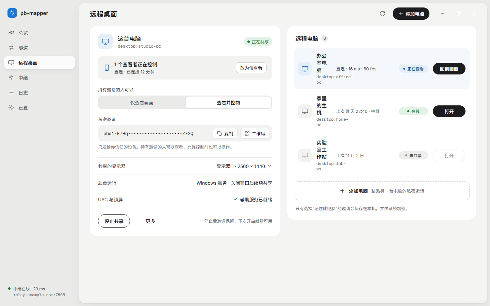

### 首次开启远程控制

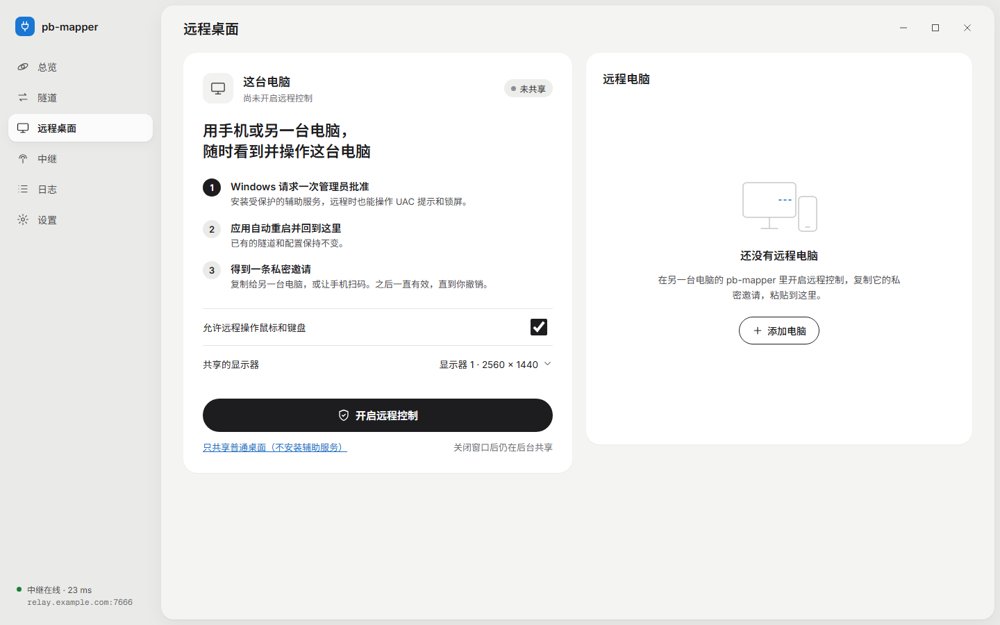

### 添加远程电脑

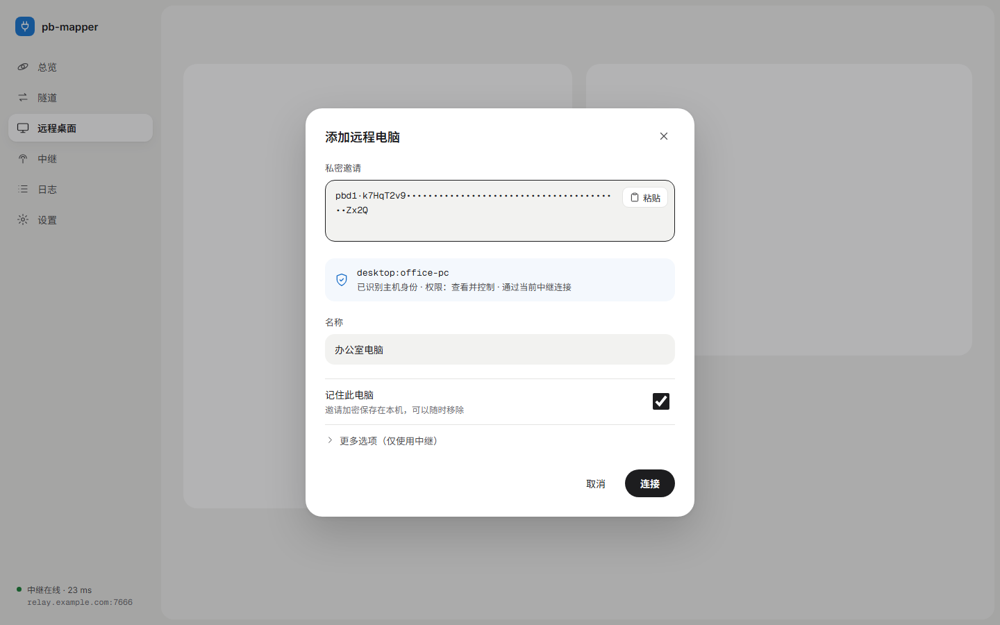

### 查看器（控制中，快捷键菜单）

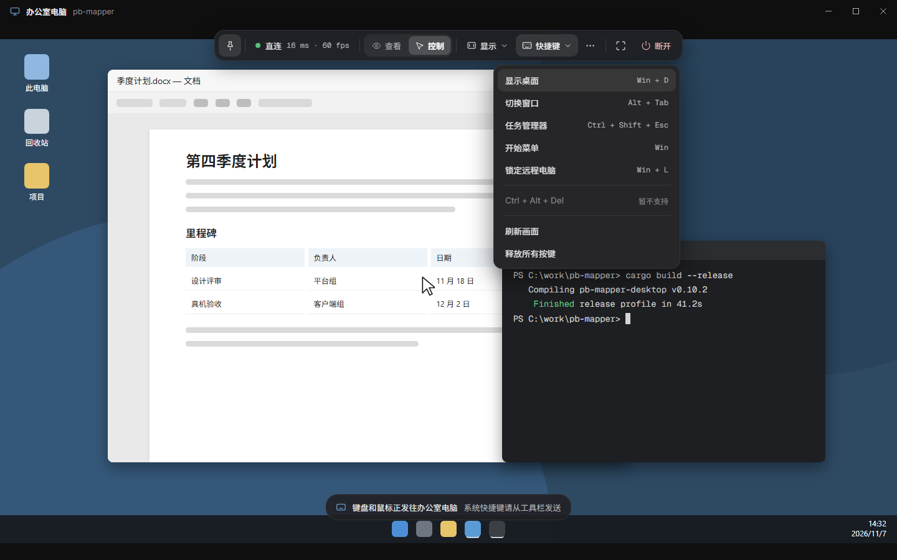

### 查看器状态

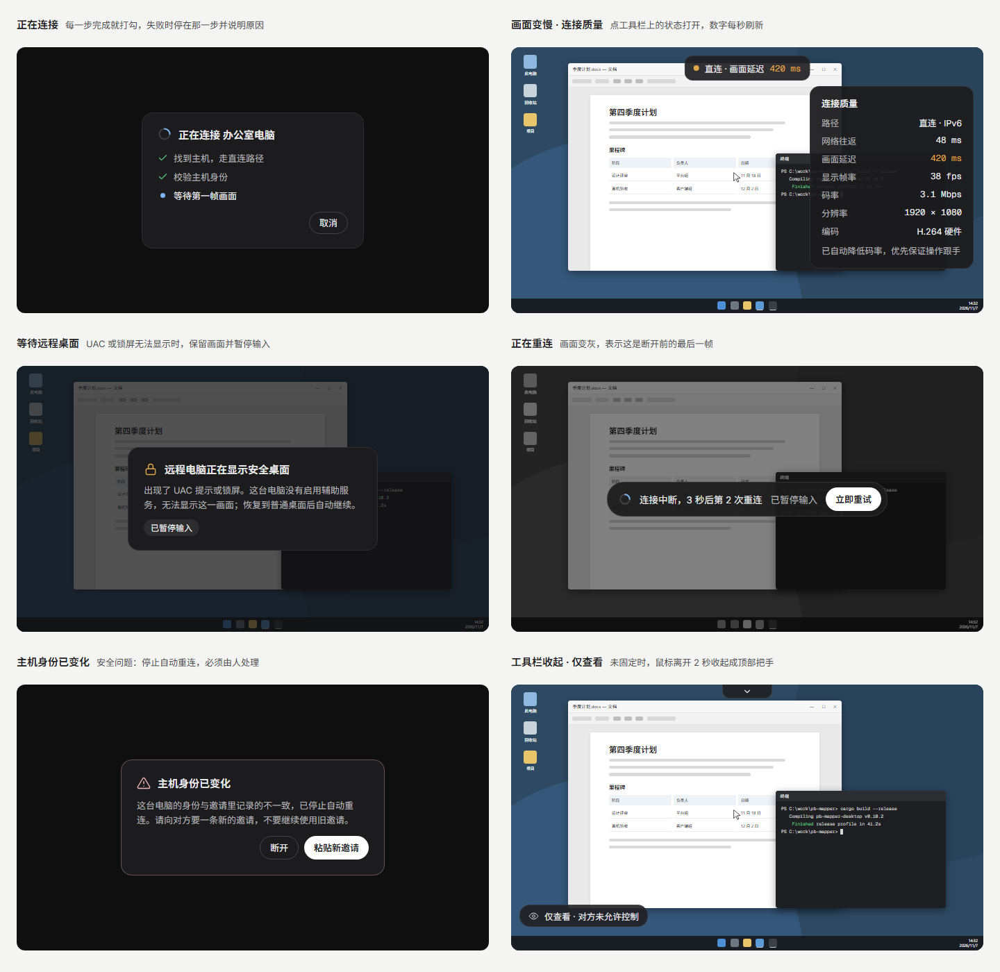

## 手机端：画面优先，控件放进两侧留白

1. 底栏加“远程”，日志移到设置里。
2. 扫电脑上的二维码添加，粘贴邀请作为备选。
3. 横屏时 16:9 画面两侧有留白，按钮全部放在留白里。
4. 触控板模式默认，手势与 RustDesk 一致：三指上下滚动，双指移动或捏合调整画面。
5. 键盘上方有修饰键条。

借鉴 RustDesk：Ctrl / Alt / Shift / Win 可锁定，Fn 切换 F1–F12，常用键和 Ctrl+C / V 一键发送；直接触摸模式可开启虚拟鼠标。

| 远程标签页 | 扫码添加电脑 | 操作方式 |
| --- | --- | --- |
| 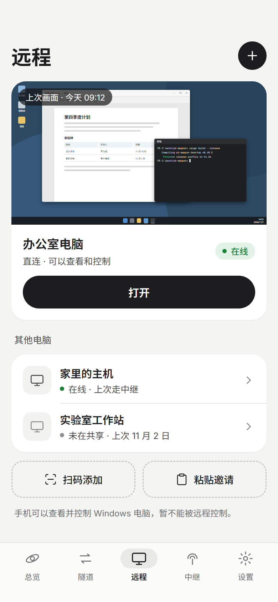 | 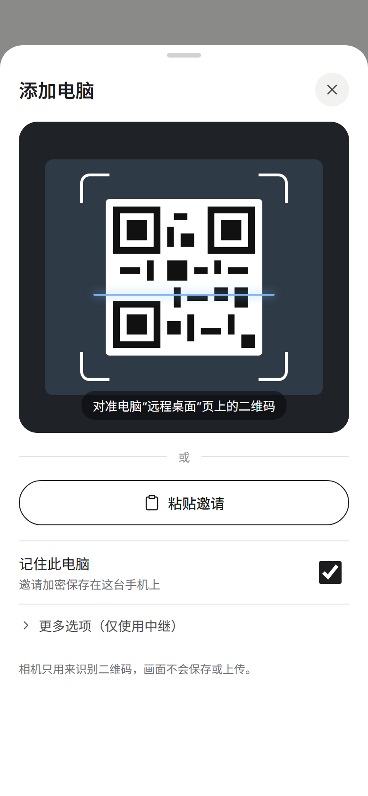 | 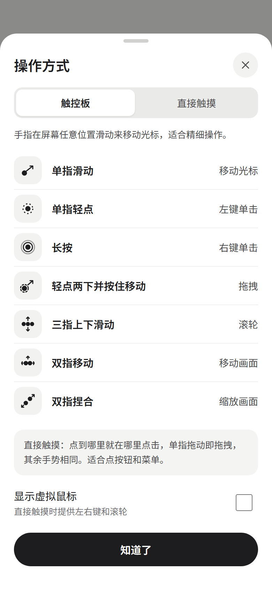 |

### 横屏查看器（触控板模式）

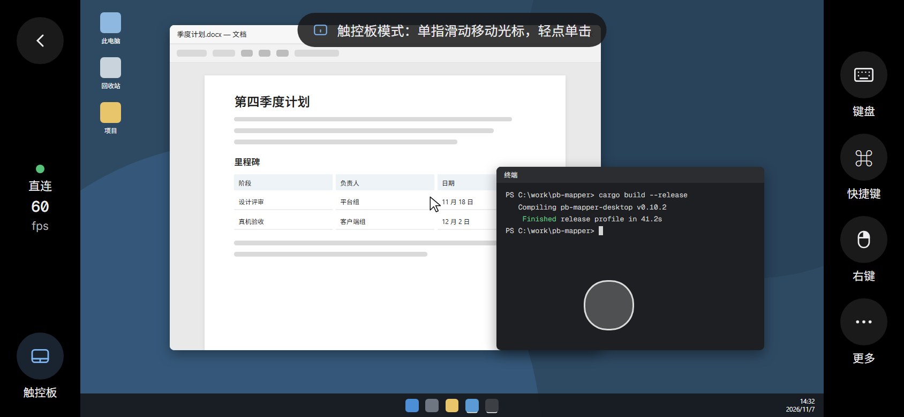

### 键盘与修饰键条

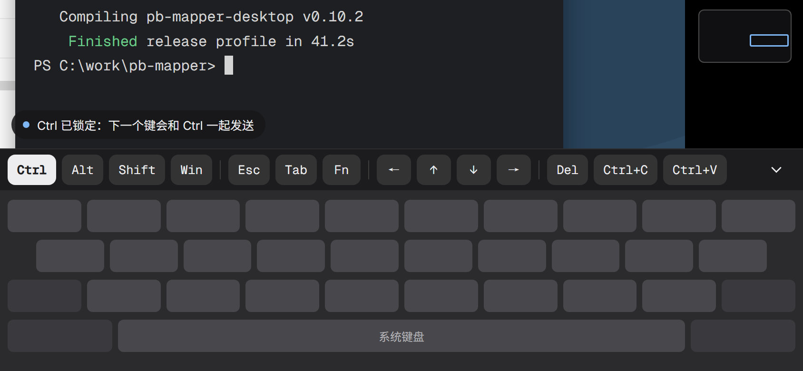

## 组件

| 桌面侧栏 | 手机底栏 |
| --- | --- |
| 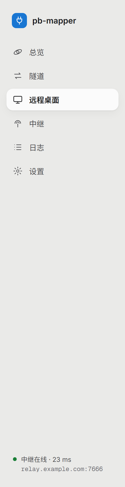 | 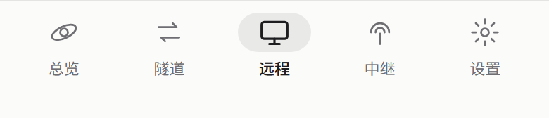 |

远程画面占位（其他画板里的远程桌面画面）：

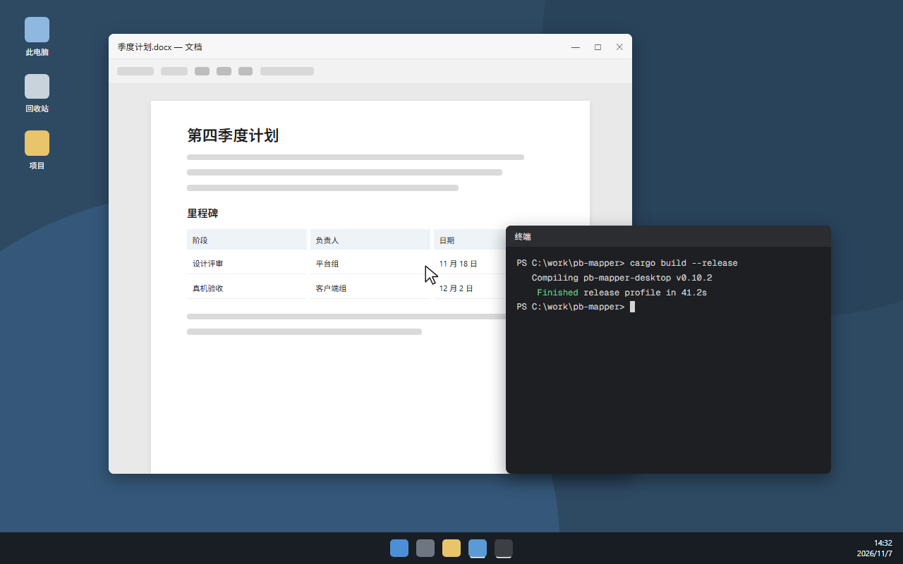

## 图标系统与标题栏修正

1. 只用一套图标：全部来自 Lucide，窗口按钮按 Windows 原生样式自绘；不再混用 Material Icons。
2. 粗细跟着尺寸走：20 px 及以下用 400，24 px 及以上用 300。
3. 四档尺寸：16 / 18 / 20 / 24。
4. 改了三处：隧道 cable → route，中继在线 / 离线 wifi → cloud；新增远程桌面一组。

图标画板里显示的是 lucide_icons_flutter 3.1.25 自带字体的真实字形。

### 图标系统

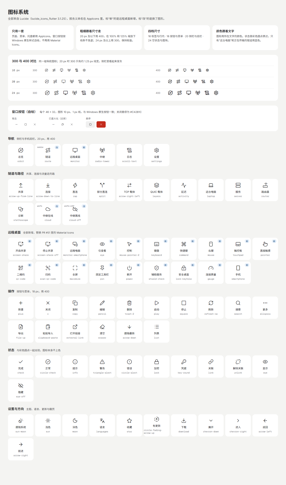

### 最初的修法：标题栏窗口按钮与内容页边缘重叠（已被下面的定稿取代）

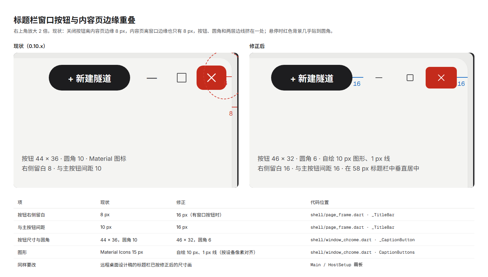

### 定稿：三个按钮贴在窗口右上角，只有一层

上面的修法仍把按钮放在一张浮在窗口底色上的圆角内容页里，看起来是两层。定稿在 Windows 和 Linux 上让内容页贴住窗口的上、右、下三边，只在靠侧栏的左上角保留圆角；三个按钮是 46 px 宽的直角方块，贴着窗口右上角，和下面的标题栏一样高（侧栏旁 58 px，窄窗口 54 px，查看器 36 px），图标和标题在同一行；悬停底色铺到两条边，关闭的红色一直到角上，和 Windows 自己的按钮一样。整个应用只有这一组按钮，画在所有页面和对话框之上：切换页面时它不动也不淡入，对话框的遮罩盖不到它；窗口不在前台时图标变淡。下面两张是应用在 125% 缩放下渲染的真实页面（`test/preview_test.dart` 的 “title bar on Windows at 125 %”），鼠标停在关闭按钮上。

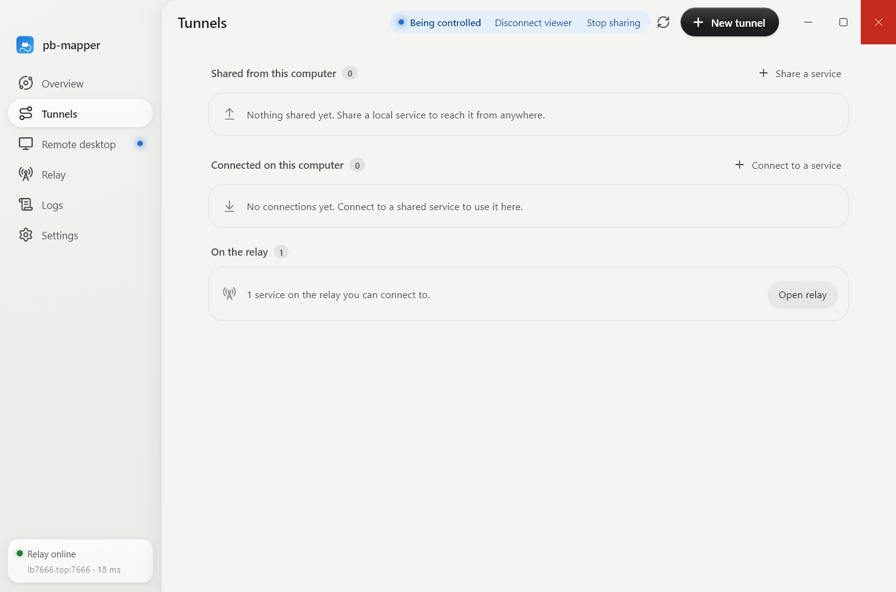

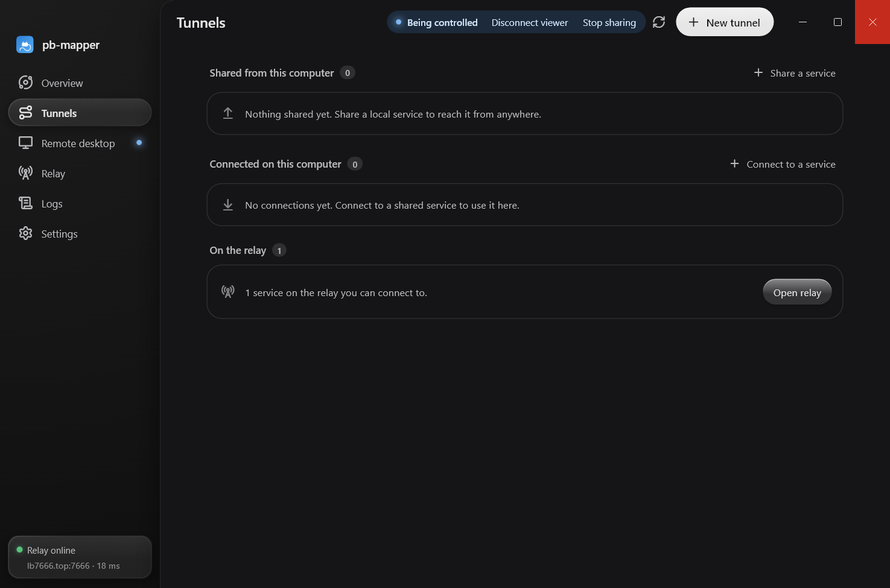
