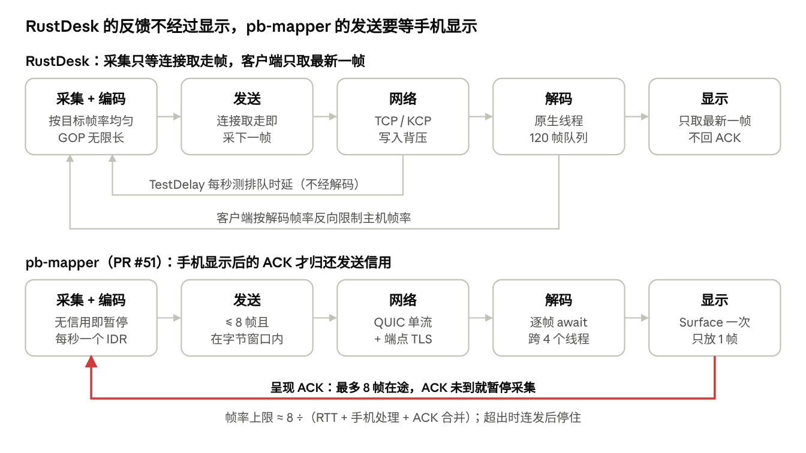

# 远程桌面流畅度优化优先级（借鉴 RustDesk）

2026-11-07

RustDesk 在手机上更顺，主要不是因为渲染更快——它的 Android 端反而走 CPU 拷贝——而是**发送节拍与画面呈现完全解耦**。它的主机按目标帧率均匀采集，只受 TCP 写入背压；客户端解码线程不等显示，只保留最新一帧；GOP 无限长；帧率每秒、码率每 3 秒按网络排队时延平滑调整。

pb-mapper（PR #51，`a41eaa7`）把发送信用绑在手机“已呈现”ACK 上，最多 8 帧在途，再叠加每秒一个 IDR 和 12 Mbps / 最高 90 fps 的目标。在蜂窝网络上，这会变成“连发几帧、停住、再连发”，即使平均帧率不低也显得卡顿。

建议先改 P0 四项：发送节拍与信用、帧率码率自适应、GOP、码率帧率目标；再改手机端流水线。以下判断来自对两边源码的阅读，尚未经真机测量证实，验收方法见“验证与验收”。

## 优先级总表

按对“直连也卡”的解释力和改动风险排序。每项的细节和代码位置见下文对应小节。

| 优先级 | 优化项 | RustDesk 的做法 | pb-mapper 现状 | 预期效果 | 工作量 |
| --- | --- | --- | --- | --- | --- |
| P0-1 | 发送信用与呈现解耦 | 采集线程只等连接任务取走帧、写入 TCP；原生客户端不发呈现 ACK | 只有手机呈现 ACK 归还信用，最多 8 帧在途 | 消除“连发—停顿”；帧率不再被 8 ÷ (RTT + 手机耗时) 封顶 | 中 |
| P0-2 | 均匀节拍的帧率/码率自适应 | 每秒测一次排队时延，平滑调帧率；码率每 3 秒调 5–20%；分辨率不变 | 等信用时暂停采集；手机处理时间被当成拥塞，可降到 640×360@30 | 帧间隔稳定，画质不被误降 | 中 |
| P0-3 | 无限 GOP、按需关键帧 | `DEFAULT_GOP = i32::MAX`，只在刷新、新订阅、解码失败时出 IDR | GOP = fps，每秒一个 IDR；超窗口的 IDR 要等在途清空 | 去掉每秒一次的流水线排空 | 小 |
| P0-4 | 码率与帧率目标 | 1080p 平衡档约 2.8 Mbps、最佳档约 4.6 Mbps；默认 30 fps，建连首秒 15 fps | 12 Mbps；帧率 = 屏幕刷新率，最高 90 | 单帧更小，蜂窝下排队和突发更少 | 小 |
| P1-1 | 手机端解码与呈现解耦 | 原生解码线程 + 队列；显示只取最新一帧，Flutter 未取走时新帧直接丢弃 | Dart 逐帧 `await submit`，每帧跨 4 个线程/isolate 后才拉下一帧 | 降低手机侧时延与抖动 | 中 |
| P1-2 | 时延反馈不走显示链路 | TestDelay 由网络任务直接回复 | 呈现 ACK 合并到 33 ms，经可能阻塞 16 ms 的帧 isolate | 反馈更准、更及时 | 小 |
| P1-3 | 输入与光标独立 | 输入注入独立线程；光标位置不回发给正在操作的客户端 | 输入与采集编码同一线程；光标状态帧占用视频拉取信用 | 操作手感不受视频影响 | 小–中 |
| P1-4 | 缩放与平移只在本地 | 手机上双指缩放只改客户端画布的比例和偏移，不通知主机；分辨率只由用户改 | 缩放已是本地变换；但光栅耗时经呈现 ACK 影响发送，画质阶梯会换分辨率并重建解码器 | 缩放时画面不重建、视频不顿 | 小（大部分随 P0-1、P0-2 完成） |
| P2-1 | 传输 | 直连用 TCP 打洞或 UDP 上的 KCP，都是可靠有序流 | QUIC 单流，同类 | 不是差异来源，只需确认桌面会话确实走直连 | 小（仅测量） |

## P0：发送节奏与流控

RustDesk 的主机不等客户端显示：一帧被连接任务取走、开始写 TCP，采集线程就睡到下一个帧间隔。网络慢时，写入阻塞自然拖慢取帧；客户端慢时，由客户端自己反向限制帧率。

### RustDesk 怎么做

-   **节拍来自传输背压。** 采集循环每帧后等所有连接“取走”该帧（最长 3 s），再睡满 `spf`（[video\_service.rs L875–895](https://github.com/rustdesk/rustdesk/blob/5f015c9da13cb227a414c6d295a5c81e5360eccb/src/server/video_service.rs#L875-L895)）。连接任务在写 TCP 之前发出“已取走”通知；只有声明 `video_ack_required` 的客户端才等 `VideoReceived`，而原生客户端从不设置它（[connection.rs L981–990](https://github.com/rustdesk/rustdesk/blob/5f015c9da13cb227a414c6d295a5c81e5360eccb/src/server/connection.rs#L981-L990)）。
-   **每秒测一次排队时延。** `TestDelay` 和视频走同一连接，客户端在网络任务里立即回复，所以它测到的是“网络 + 发送缓冲排队”，不含解码和显示。主机取最近 3 个样本均值，减去由历史最小值得到的基线 RTT（[video\_qos.rs L246](https://github.com/rustdesk/rustdesk/blob/5f015c9da13cb227a414c6d295a5c81e5360eccb/src/server/video_qos.rs#L246)、[L540](https://github.com/rustdesk/rustdesk/blob/5f015c9da13cb227a414c6d295a5c81e5360eccb/src/server/video_qos.rs#L540)）。
-   **帧率平滑升降。** 排队时延 < 50 ms 逐步加帧（连续 3 次好样本 +5）；50–150 ms 只缓慢上调；≥ 150 ms 按 `fps ÷ (时延 / 150)` 降。客户端响应超过 2 s 时直接降到 2 fps。
-   **码率慢调、分辨率不动。** 码率比例每 3 s 调一次：时延低且画面在变时 +5–15%，单次最多 +150 kbps；时延高时 −5–20%（[video\_qos.rs L416](https://github.com/rustdesk/rustdesk/blob/5f015c9da13cb227a414c6d295a5c81e5360eccb/src/server/video_qos.rs#L416)）。编码分辨率始终是屏幕分辨率，不重建编码器。
-   **客户端反向限速。** 客户端按自己的解码帧率把主机帧率限到其 90%（直连）或 80%（中继），队列积压就减半；超过容忍度则请求刷新并丢弃队列（[io\_loop.rs L1173](https://github.com/rustdesk/rustdesk/blob/5f015c9da13cb227a414c6d295a5c81e5360eccb/src/client/io_loop.rs#L1173)）。

### pb-mapper 对应位置

-   `crates/pb-mapper-desktop/src/congestion.rs`：`MAX_FRAMES = 8`；`admit` 在在途满 8 帧或超字节窗口时返回 `Wait`；只有 `presented` 归还信用。
-   `crates/pb-mapper-desktop/src/worker.rs`：`paused = waiting`，等信用时停止提交新采集，信用回来后按 fps 连发，形成“连发—停顿”。
-   `desired_window` 与 `congested_after` 用启动探测测得的纯网络 RTT，但 ACK 含手机解码、vsync 和 33 ms 合并。平均呈现时延超过 250 ms 就减半码率，并按码率降分辨率，最低档 640×360@30。

### 建议改法

1.  把“在途信用”改为按**接收**归还：查看器的网络读取任务收到一帧就回一个累计确认，不经 FFI、Dart 或解码。窗口按 帧率 × RTT 加余量计算，不再固定 8 帧。
2.  呈现滞后由查看器本地处理：只保留最新可解码帧；积压超过阈值时，和 RustDesk 一样反向下调主机帧率或请求 IDR。
3.  采集按当前目标帧率均匀节拍，不用“暂停/恢复”做流控。拥塞时先降帧率和码率，分辨率只在长期低带宽时才降。
4.  拥塞判定只用“传输时延 − 基线 RTT”，不把手机处理时间算进去。现有的启动探测可以扩展为每秒一次的周期探测。

安全边界不变：输入控制仍由“新鲜的已呈现帧”授权。这与发送信用是两件事，呈现 ACK 可以保留给输入授权，只是不再控制发送。

## P0：编码参数

RustDesk 只在需要时发关键帧，并把 1080p 的码率控制在约 3–5 Mbps；pb-mapper 每秒一个 IDR、目标 12 Mbps，两者叠加会周期性地撑满发送窗口。

### RustDesk 怎么做

-   **无限 GOP。** 非录屏时 `keyframe_interval` 为 `None`（[video\_service.rs L981](https://github.com/rustdesk/rustdesk/blob/5f015c9da13cb227a414c6d295a5c81e5360eccb/src/server/video_service.rs#L981)），硬件编码器取 `DEFAULT_GOP = i32::MAX`（`libs/scrap/src/common/hwcodec.rs` L30、L71），显存直编路径取 `MAX_GOP`（`vram.rs` L69）。关键帧只在刷新、新订阅、切换显示或客户端解码出错时产生。
-   **桌面端 CBR。** `rate_control` 在桌面端返回 `RC_CBR`，Android MediaCodec 用 VBR（`hwcodec.rs` L243）。
-   **码率按分辨率查表。** 1080p 基准 2073 kbps（`codec.rs` L929），乘画质比例（平衡 0.67、最佳 1.5）和 H.264 系数（低于 2000 kbps 时 ×2，以上逐渐趋近 ×1）。平衡档约 2.8 Mbps，最佳档约 4.6 Mbps。
-   **默认 30 fps。** QoS 的默认和客户端 `custom_fps` 默认都是 30，上限 120；新连接第一秒限 15 fps（[video\_qos.rs L30–33](https://github.com/rustdesk/rustdesk/blob/5f015c9da13cb227a414c6d295a5c81e5360eccb/src/server/video_qos.rs#L30-L33)）。
-   **画面不变时不编码。** DXGI 以 `spf` 为超时等待画面变化；只有会缓存帧的编码器（MediaCodec、VideoToolbox）才重复编码上一帧，最多 10 次，用来把缓存的帧推出来。

### pb-mapper 对应位置

-   `crates/pb-mapper-desktop/src/video/windows.rs` L607：`CODECAPI_AVEncMPVGOPSize = fps`，运动画面下每秒一个 IDR。
-   `congestion.rs::admit`：超过字节窗口的 IDR 要等在途帧全部 ACK 后才能发，发出后后续帧又要等它的 ACK，相当于每秒空转约 2 个反馈周期。等待超过 250 ms 则丢弃并再请求一个 IDR。
-   `ui/lib/src/ffi/desktop_api.dart` L433–444：请求 `max_fps` = 屏幕刷新率（30–90）、`bitrate` = 12 Mbps。120 Hz 手机会要 90 fps，8 帧窗口只够 89 ms。

### 建议改法

1.  GOP 设为最大值，只在重同步、分辨率变化、新会话或解码器请求时发 IDR。若担心长时间无 IDR 后丢包恢复慢，再评估帧内刷新（intra refresh），而不是短 GOP。
2.  手机默认目标改为 1080p、约 4 Mbps、60 fps 以内（不超过实测 Flutter 帧率），由 P0-2 的自适应往上试探。先与 RustDesk 同档对照，再定上限。
3.  确认 NVIDIA MFT 的 CBR VBV 大小。若单帧预算允许 IDR 远大于 P 帧，给窗口预留一个 IDR 的余量，而不是要求在途清空。

## P1：接收、解码与渲染

RustDesk 客户端的每一级都不等下一级：网络任务入队、解码线程解码、显示取最新一帧。pb-mapper 的解码与呈现用 SurfaceTexture 硬件路径，本身比 RustDesk 的 CPU 路径更省，应保留；要改的是中间的逐帧停等。

### RustDesk 怎么做

-   **入队不等解码。** 网络任务把非关键帧 `force_push` 进 120 帧的无锁队列，关键帧直接发给解码线程；队列溢出则请求刷新（[io\_loop.rs L1323–1352](https://github.com/rustdesk/rustdesk/blob/5f015c9da13cb227a414c6d295a5c81e5360eccb/src/client/io_loop.rs#L1323-L1352)）。
-   **每个显示器一个原生解码线程**，并统计实际解码帧率，供上节的反向限速使用（[client.rs L2855](https://github.com/rustdesk/rustdesk/blob/5f015c9da13cb227a414c6d295a5c81e5360eccb/src/client.rs#L2855)）。
-   **显示只取最新一帧。** 每个显示器一个 RGBA 槽位；Flutter 还没取走上一帧时，新解码的帧直接放弃，缓冲区交换复用（[flutter.rs L1196](https://github.com/rustdesk/rustdesk/blob/5f015c9da13cb227a414c6d295a5c81e5360eccb/src/flutter.rs#L1196)）。Dart 收到事件后取数据、`decodeImageFromPixels`，完成后才调 `nextRgba` 释放槽位。
-   **呈现不反馈给主机。** 原生客户端没有逐帧显示确认；主机只看到 TestDelay 和客户端发来的帧率上限。
-   **不要照搬的部分。** Android 端 MediaCodec 解码到 YUV420P 缓冲区，在 Rust 里转 RGBA，再由 Dart 上传为纹理（`libs/scrap/src/common/mediacodec.rs`），每帧多次整帧拷贝。它顺，是因为节拍解耦而且默认只要 30 fps，不是因为这条渲染路径。

### pb-mapper 对应位置

-   `ui/lib/src/state/desktop_store.dart` 的 `_consumeFrames` / `_acceptFrame`：每帧 `await texture.submit`，等 MediaCodec 接收输入后才 `moveNext`。`ui/lib/src/ffi/pb_mapper_service.dart` 的帧 isolate 只有 1 个信用。一帧要经过帧 isolate → Dart 主 isolate → 平台线程 → 解码线程再回来，下一帧才开始取。Flutter 合并 UI 与平台线程后，这些跳转还要排在 UI 绘制后面。
-   `ui/android/app/src/main/kotlin/com/pb_mapper/ui/DesktopVideo.kt`：Surface 上只允许 1 帧，等 Flutter `updateTexImage` 回调后才释放下一帧；解码器加输出队列合计最多 4 帧。这部分本身合理，它已经会跳过被新帧取代的旧帧。

### 建议改法

1.  压缩帧从 Rust 直接交给 Kotlin 解码器（JNI 或共享队列），不经 Dart 主 isolate 和 MethodChannel。Dart 只拿状态和几何信息。
2.  如果暂时保留 Dart 路径：允许 2–3 个 `submit` 同时在途，把 MethodChannel 放到 `makeBackgroundTaskQueue()`，不再逐帧停等。
3.  在查看器统计实际解码/呈现帧率，按 RustDesk 的方式把主机帧率限在它的 90%；积压时丢弃并请求 IDR，而不是让主机停等。

## P1：输入、光标与反馈通道

RustDesk 的输入、光标和时延反馈各走各的路，不与视频帧争抢同一个线程或信用。pb-mapper 里这三样都和视频链路纠缠在一起。

### RustDesk 怎么做

-   **输入注入在独立线程。** 每个连接启动一个 `handle_input` 线程接收鼠标键盘消息（[connection.rs L645、L1158](https://github.com/rustdesk/rustdesk/blob/5f015c9da13cb227a414c6d295a5c81e5360eccb/src/server/connection.rs#L1158)），与采集编码线程无关。
-   **光标位置 33 ms 一次，且不回发给操作者。** `run_pos` 用 `send_without` 排除 300 ms 内发过输入的连接（[input\_service.rs L336–393](https://github.com/rustdesk/rustdesk/blob/5f015c9da13cb227a414c6d295a5c81e5360eccb/src/server/input_service.rs#L336-L393)）。操作者在本地画光标，不等往返。光标形状另有一个 33 ms 的服务。
-   **时延反馈由网络任务直接回复。** 客户端收到 `TestDelay` 就在 io\_loop 里发回，不经过解码或 UI。

### pb-mapper 对应位置

-   `crates/pb-mapper-desktop/src/worker.rs`：输入、呈现 ACK 和关键帧请求都进采集编码线程的同一个循环；主机的接收任务还要等该线程回复后才读下一条命令。
-   主机每 16 ms 采样一次光标并单独发状态；查看器的 `media.rs::Queue::pop` 先返回状态帧再返回视频帧，它们共用帧 isolate 的单个信用。拖动鼠标时，视频的拉取轮次最多减半。
-   `desktop_store.dart::_flushFeedback` 把呈现 ACK 合并到最多每 33 ms 一次；`presented`、`input` 都路由到帧 isolate，而它可能正阻塞在 `wait_frame`（最长 16 ms，`ui/native/pb_mapper_ffi/src/desktop.rs` L181）。

### 建议改法

1.  主机输入注入移到独立线程，保留现有的授权检查、桌面句柄绑定和失败即终止控制的语义。
2.  光标状态不进入视频队列：FFI 提供“最新光标”的非阻塞读取，由 Dart 按渲染帧轮询。操作者正在拖动时本地画光标，主机不回发其位置。
3.  输入和反馈走非阻塞 FFI 调用，不经过阻塞在 `wait_frame` 的 isolate。如果 P0-1 改为接收确认，33 ms 合并只影响输入授权，可以保留。

## P1：缩放与平移只在本地

在 RustDesk 安卓端看到的现象，源码里能对上：双指缩放和平移只改客户端画布的缩放比例和偏移，不给主机发任何消息，不改编码参数，也不重建解码器。手势期间 Flutter 只是把同一张已解码的画面按新比例再画一次；新画面按网络节拍到达，两者互不影响。

### RustDesk 怎么做

-   **手势只改本地画布。** 手机上双指缩放调用 `canvasModel.updateScale` 并平移画布，不发送任何东西（[remote\_input.dart L486–492](https://github.com/rustdesk/rustdesk/blob/5f015c9da13cb227a414c6d295a5c81e5360eccb/flutter/lib/common/widgets/remote_input.dart#L486-L492)）。`updateScale` 只改 `_scale`、`_x`、`_y`，保持手指下的画面位置不动，然后通知重绘（[model.dart L2686–2705](https://github.com/rustdesk/rustdesk/blob/5f015c9da13cb227a414c6d295a5c81e5360eccb/flutter/lib/models/model.dart#L2686-L2705)）。缩放范围从“适配屏幕 ÷ 1.5”到“max(1.5, 铺满屏幕)”（[L1987–2002](https://github.com/rustdesk/rustdesk/blob/5f015c9da13cb227a414c6d295a5c81e5360eccb/flutter/lib/models/model.dart#L1987-L2002)）。
-   **重绘只是把最新一帧再画一次。** `ImagePaint` 用 `canvas.scale` 加 `drawImage` 画当前的 `ui.Image`，比例不是 1:1 时用 `FilterQuality.medium`（[mobile/pages/remote\_page.dart L1141–1162](https://github.com/rustdesk/rustdesk/blob/5f015c9da13cb227a414c6d295a5c81e5360eccb/flutter/lib/mobile/pages/remote_page.dart#L1141-L1162)、[utils/image.dart L93–133](https://github.com/rustdesk/rustdesk/blob/5f015c9da13cb227a414c6d295a5c81e5360eccb/flutter/lib/utils/image.dart#L93-L133)）。
-   **分辨率只在用户明确选择时变。** 手机端只有“分辨率”菜单会调用 `sessionChangeResolution`（[remote\_page.dart L1464–1481](https://github.com/rustdesk/rustdesk/blob/5f015c9da13cb227a414c6d295a5c81e5360eccb/flutter/lib/mobile/pages/remote_page.dart#L1464-L1481)）；视图样式只写本地配置（[client.rs L1960–1964](https://github.com/rustdesk/rustdesk/blob/5f015c9da13cb227a414c6d295a5c81e5360eccb/src/client.rs#L1960-L1964)）；QoS 也从不改编码分辨率（见 P0-2）。
-   **弹出键盘不丢缩放。** 键盘弹出前记下缩放和偏移，收起后恢复（[model.dart L2756–2779](https://github.com/rustdesk/rustdesk/blob/5f015c9da13cb227a414c6d295a5c81e5360eccb/flutter/lib/models/model.dart#L2756-L2779)）。
-   **桌面端不一样。** 触屏电脑上的双指缩放会作为触控 `scale` 事件转发给远端，由远端应用自己缩放（[remote\_input.dart L474–485](https://github.com/rustdesk/rustdesk/blob/5f015c9da13cb227a414c6d295a5c81e5360eccb/flutter/lib/common/widgets/remote_input.dart#L474-L485)）。本地缩放是移动端的做法。

### pb-mapper 对应位置

-   **缩放本身已经是本地变换。** `ui/lib/src/pages/desktop_gesture_surface.dart` 的 `_scaleUpdate` 和 Ctrl+滚轮只改 `_scale`、`_offset`，以 `Transform` 套在 `RepaintBoundary(Texture)` 外面，两指手势不发送指针输入。`ui/test/desktop_gesture_test.dart` 已断言捏合时不发输入、`Texture` 不重建。范围是适配屏幕的 1–8 倍。
-   **“缩放不花钱”目前依赖关闭 Impeller。** `ui/android/app/src/main/AndroidManifest.xml` 的注释写明：在 Impeller 的 Vulkan 兼容路径下，SurfaceTexture 每次绘制（包括捏合）都会被拷贝并缩放到变换后的视口，所以改回了 OpenGL。
-   **光栅耗时仍会传到发送节拍。** 呈现回执来自 Flutter 光栅线程取走 SurfaceTexture 的那一帧。缩放时光栅只要掉一帧，ACK 就晚到，主机的发送信用跟着卡住（P0-1）。RustDesk 客户端不发呈现 ACK，本地怎么画都影响不到主机。
-   **分辨率会在用户没操作时变。** 画质阶梯（P0-2）会随码率把分辨率一路降到 640×360。尺寸一变，`DesktopVideo.kt` 的 `configure` 就释放并重建 MediaCodec、重设 `setDefaultBufferSize`、等新的 IDR，画面会明显重建一次。RustDesk 缩放时不会出现这种情况。

### 建议改法

1.  写成约束：缩放、平移、旋转、软键盘、窗口尺寸变化都只在查看器本地处理，不发给主机，不改编码参数，不重建解码器或纹理。现有手势测试已覆盖“不发输入、不重建纹理”，保持即可。
2.  随 P0-1 改为按接收归还信用，本地绘制的快慢就不再影响主机发送。
3.  随 P0-2 让自动调节只动帧率和码率。分辨率只在用户选择、切换显示器或长期低带宽时变化，同一会话内不来回切换。
4.  软键盘弹出和收起时保持缩放与偏移，照 RustDesk 的做法记下再恢复。pb-mapper 目前按视口中心保持比例，需确认弹出键盘后远端光标仍在可见区域。
5.  每次升级 Flutter 都在真机上测一次捏合。如果关闭 Impeller 的开关被移除，或新渲染器仍逐帧拷贝纹理，要重新评估纹理接入方式。

## P2：传输

传输层不是差异来源：两边都是单条可靠有序流，丢包时都会队头阻塞。这里只需要确认桌面会话自己走的是什么路径。

-   **RustDesk。** 直连用 TCP 打洞或 UDP 打洞上的 KCP（[kcp\_stream.rs](https://github.com/rustdesk/rustdesk/blob/5f015c9da13cb227a414c6d295a5c81e5360eccb/src/kcp_stream.rs)），失败后走中继 TCP。TCP 开启 `nodelay`；视频发送超时 12 s。视频和其他消息用两个队列，在同一个 `select!` 里公平取用。
-   **pb-mapper。** 直连是 quinn QUIC 单流，默认 Cubic，流窗口 8 MiB（`crates/pb-mapper-client/src/direct/identity.rs`），其上再套端点 TLS。中继是 TCP 或 QUIC。
-   **要补的证据。** 交接文档里的直连证据来自普通 `llm-frontend` 隧道。卡顿的那次桌面会话的 `path`、RTT 和丢包，需要单独记录。
-   **暂不建议。** 在 P0 完成前，不要换成不可靠数据报或多流；发送节奏问题不解决，换传输也不会变顺。

## 验证与验收

先用现有埋点跑一次真机，确认根因再动代码；每项改动后在同一场景下与 RustDesk 对照。

### 改之前：一次真机运行即可定位

| 要确认的问题 | 在哪里看 | 支持哪一项 |
| --- | --- | --- |
| 主机是否常在等信用 | 主机 `RUST_LOG=pb_mapper_desktop::feedback=debug`，每秒 `desktop_feedback_interval` 的 `waiting`、`outstanding_frames` | P0-1 |
| 码率和画质是否被误降 | 同一日志的 `action`（`decrease`、`ack_stall`）、`bitrate`、`quality`、`delay_ms` 与 `baseline_ms` | P0-2 |
| 是否每秒卡一次 | 帧间隔分布里约 1 s 周期的长停顿；IDR 计数 | P0-3 |
| 手机端占了多少时间 | Android 视频通道 `stats`（开启 timings）的 `receive_to_present`、`input_wait`、`decode_callback` | P1-1 |
| 桌面会话走的路径 | 查看器状态的 `path` 和直连阶段 | P2-1 |
| 缩放时视频是否变卡 | 持续捏合 10 s 期间，主机日志的 `waiting`、`quality`，以及帧间隔分布 | P1-4 |

### 改之后：同条件对照

-   同一主机、手机、网络、分辨率和动态画面（例如滚动网页、拖动窗口各 60 s），分别跑 pb-mapper 和 RustDesk。RustDesk 画质设为“平衡”，pb-mapper 用相近码率。
-   记录真实呈现帧率、帧间隔 p50/p95/最大值、超过 100 ms 的停顿次数、端到端与输入到显示时延。跨端时延用外部拍摄或时钟校准测量。
-   不用配置帧率、接收帧数或模拟 ACK 代替屏幕呈现；平均帧率不能掩盖长停顿。
-   回归项：慢消费者下队列仍有界；重连不重放输入；输入授权仍由新鲜的已呈现帧决定。
-   缩放场景：在动态画面上连续双指缩放、平移 10 s。主机的 `quality` 和分辨率不变，没有关键帧请求，Android 解码器不重建；呈现帧率和帧间隔 p95 与不缩放时一致。

只有用户认可体验后，PR #51 的合并阻塞才能解除。

## 对照图

从采集到显示 · RustDesk 与 pb-mapper 的反馈点

RustDesk 的两条反馈只看网络和解码能力，不等显示；pb-mapper 的红色回路把手机显示纳入发送节拍，往返越长，连发后的停顿越明显。

## 来源

RustDesk 源码取自上游 [rustdesk/rustdesk](https://github.com/rustdesk/rustdesk) 提交 `5f015c9`（2026-07-18），本地副本 `<rustdesk checkout>`。pb-mapper 代码取自 PR #51 分支 `codex/issue-50-remote-desktop` 的 `a41eaa7`。

-   [src/server/video\_service.rs](https://github.com/rustdesk/rustdesk/blob/5f015c9da13cb227a414c6d295a5c81e5360eccb/src/server/video_service.rs)：采集循环、取帧等待、编码器配置
-   [src/server/video\_qos.rs](https://github.com/rustdesk/rustdesk/blob/5f015c9da13cb227a414c6d295a5c81e5360eccb/src/server/video_qos.rs)：帧率与码率自适应、RTT 基线
-   [src/server/connection.rs](https://github.com/rustdesk/rustdesk/blob/5f015c9da13cb227a414c6d295a5c81e5360eccb/src/server/connection.rs)：视频发送、TestDelay、输入线程
-   [src/server/input\_service.rs](https://github.com/rustdesk/rustdesk/blob/5f015c9da13cb227a414c6d295a5c81e5360eccb/src/server/input_service.rs)：光标位置与形状服务
-   [src/client.rs](https://github.com/rustdesk/rustdesk/blob/5f015c9da13cb227a414c6d295a5c81e5360eccb/src/client.rs)：视频队列与解码线程
-   [src/client/io\_loop.rs](https://github.com/rustdesk/rustdesk/blob/5f015c9da13cb227a414c6d295a5c81e5360eccb/src/client/io_loop.rs)：入队、客户端帧率控制与刷新
-   [src/flutter.rs](https://github.com/rustdesk/rustdesk/blob/5f015c9da13cb227a414c6d295a5c81e5360eccb/src/flutter.rs)：RGBA 槽位与 Flutter 纹理交接
-   [flutter/lib/models/model.dart](https://github.com/rustdesk/rustdesk/blob/5f015c9da13cb227a414c6d295a5c81e5360eccb/flutter/lib/models/model.dart)：Dart 侧取帧与 `nextRgba`
-   [flutter/lib/common/widgets/remote\_input.dart](https://github.com/rustdesk/rustdesk/blob/5f015c9da13cb227a414c6d295a5c81e5360eccb/flutter/lib/common/widgets/remote_input.dart)、[flutter/lib/mobile/pages/remote\_page.dart](https://github.com/rustdesk/rustdesk/blob/5f015c9da13cb227a414c6d295a5c81e5360eccb/flutter/lib/mobile/pages/remote_page.dart)、[flutter/lib/utils/image.dart](https://github.com/rustdesk/rustdesk/blob/5f015c9da13cb227a414c6d295a5c81e5360eccb/flutter/lib/utils/image.dart)：双指缩放、画布绘制、分辨率菜单
-   [libs/scrap/src/common/hwcodec.rs](https://github.com/rustdesk/rustdesk/blob/5f015c9da13cb227a414c6d295a5c81e5360eccb/libs/scrap/src/common/hwcodec.rs)、[vram.rs](https://github.com/rustdesk/rustdesk/blob/5f015c9da13cb227a414c6d295a5c81e5360eccb/libs/scrap/src/common/vram.rs)、[codec.rs](https://github.com/rustdesk/rustdesk/blob/5f015c9da13cb227a414c6d295a5c81e5360eccb/libs/scrap/src/common/codec.rs)、[mediacodec.rs](https://github.com/rustdesk/rustdesk/blob/5f015c9da13cb227a414c6d295a5c81e5360eccb/libs/scrap/src/common/mediacodec.rs)：GOP、码率控制、码率表、Android 解码
-   [src/kcp\_stream.rs](https://github.com/rustdesk/rustdesk/blob/5f015c9da13cb227a414c6d295a5c81e5360eccb/src/kcp_stream.rs)：UDP 直连上的 KCP 流
-   pb-mapper：`docs/validation/desktop-input-backpressure.md` 的性能交接一节
