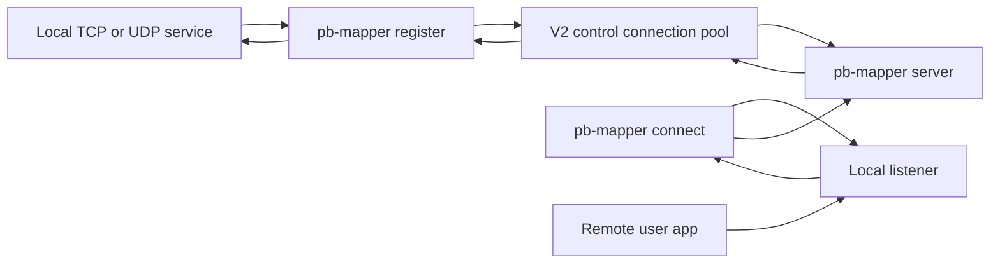
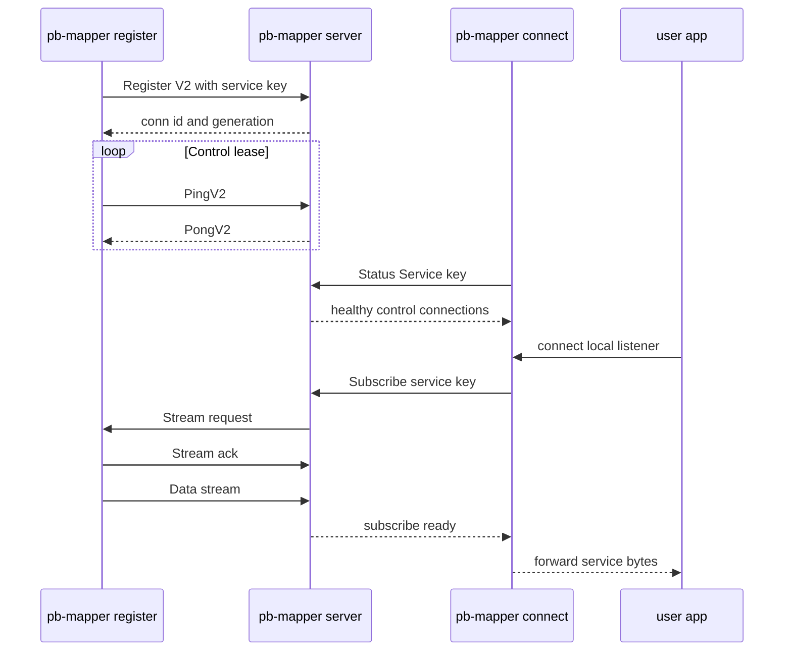

# pb-mapper User Guide

[English](user-guide.md) | [中文](user-guide.zh-CN.md)

## Overview

pb-mapper exposes local TCP/UDP services through a public relay using a service key. One `pb-mapper` binary provides the `server`, `register`, `connect`, `status`, and `admin` commands, alongside an optional Flutter GUI.

## How it works

The relay carrier defaults to TCP. To opt in to QUIC, start the server with
`--quic-listen 0.0.0.0:7667` and add `--relay-transport quic` to `register` and/or
`connect`. Keep TCP 7666 accessible for authenticated discovery and open UDP
7667. `--quic-advertise-port` overrides the public UDP port for NAT mappings.
This is independent of direct connections and the local TCP/UDP service type;
`--relay-only` disables direct coordination while allowing the explicit QUIC
listener. See [QUIC relay, SDKs and diagnostics](relay-quic.zh-CN.md) (Chinese).



The `server` role is the public rendezvous point. A `register` process registers one service key and keeps a small pool of long-lived control connections to the relay. A `connect` process first checks that the requested service key has a healthy registered control connection, then opens a local listener for downstream users.

When a user connects to the connect-side local listener, that process subscribes to the service key. The relay selects a healthy registered control connection, asks the matching register process to open a data stream, waits for an acknowledgement, and then forwards bytes between the client stream and the local service.



Control connections use leases and a receive watchdog. After the tolerance window, a register worker probes the exact `conn_id` and `generation`; a missing registration triggers reconnection. No inbound control activity beyond tolerance plus grace also triggers reconnection, even if the status probe still lists the socket. A single slow stream ACK first marks a relay candidate suspect; authenticated activity during its confirmation grace preserves the registration. Connect listeners stay bound while one background probe checks reachability, and healthy data streams survive control reconnection. See [weak-network recovery](weak-network-recovery.md) for deadlines, resource bounds, and fault tests.

### Direct connections (default)

Each new connection first tries a peer-to-peer path. The consumer asks the relay
for a session grant, both ends learn their public UDP address from the relay's
STUN service, punch through their NATs, and open a mutually authenticated QUIC
connection. The publisher dials its local service only after StartDirect.
Failures before that commit point use the relay; failures after it never replay
the request or dial the backend again. After a fallback the
tunnel sends its next connections straight to the relay for a while (10 s,
doubling to 5 min, cleared by a direct success or a network change).

Direct needs nothing to be configured: the relay listens for it on its TCP port
number over UDP, and every role allows it by default. `--relay-only` on
`server`, `register` or `connect` turns it off for that side. Established direct
sessions belong to the two endpoints: a relay restart or a revoked credential
stops new setups but does not cut them, while stopping the local tunnel does.

Nested NAT can work when the mapping and filtering rules permit it. Candidate
selection preserves both IPv4 and IPv6, and authenticated probes trigger a
return-path check of their actual source address, even if STUN saw a different
mapping. Reachable global IPv6 can bypass IPv4 NAT, subject to UDP firewall
rules. If neither peer's first packet can arrive, or UDP is blocked, relay
fallback remains necessary.

Gateway port mapping is optional and off by default. A tunnel that asks for
it has the router map its direct UDP port with PCP, NAT-PMP or UPnP; the
library renews the lease, looks for the router again after a network change,
and releases the lease when the tunnel stops. It never holds up a session: the
first connection may use the relay before later ones can use the mapping. A
relay-only tunnel never asks. Mapping the home router alone does not get
through an upstream carrier NAT, which must permit punching, map a port
itself, or offer something like a PCP proxy.

- CLI: build with `cargo build -p pb-mapper-cli --features port-mapping`, then
  add `--port-mapping` to `register` or `connect`.
- Rust SDK: the same Cargo feature, and `port_mapping: true` in
  `RegisterOptions` or `ConnectOptions`.
- Node: `portMapping: true` in the `register` or `connect` request.
- App: **Port mapping**, under **Allow direct connections** (or **Try direct
  first**) in a tunnel's **More options**. The choice is saved with the tunnel
  and kept while direct is off.

To watch a tunnel, Rust handles have `subscribe_events()` and Node handles
`subscribeEvents()`: the outcomes a tunnel kept, then every event as it
happens, including relay phases, direct stages and each change of the port
mapping. Each reader has its own bounded queue and is told how many events it
missed if it falls behind. In the app, a running tunnel's **Diagnostics**,
from its menu or its panel in the overview, shows the same live, and copies
it as a JSON report. A PCP or NAT-PMP release is reported as **sent**, since
those routers do not acknowledge it; a UPnP one as released once the router
answers.

## Prerequisites

- Optional: Flutter SDK for the GUI (`ui/`)
- Optional: Docker/Compose for container deployment (see `DOCKER_README.md`)

## Install (recommended)

Download prebuilt binaries from GitHub Releases and extract them:

- Releases: https://github.com/acking-you/pb-mapper/releases

Each target has one archive, named `pb-mapper-<target>.tar.gz` on Unix-like systems or `pb-mapper-<target>.zip` on Windows. After extracting, add `pb-mapper` to your PATH or run it from the extracted folder.

### Install with Cargo

If a Rust toolchain is already available, install the same unified executable
directly from crates.io:

```bash
cargo install pb-mapper-cli --locked
```

The crate is named `pb-mapper-cli`, while the installed executable is named
`pb-mapper`. It includes the relay server and every client/admin role, so this
single command is sufficient for both relay and client machines.

## Build from source (optional)

### Rust binaries

Requires the Rust toolchain (see `rust-toolchain.toml` for the pinned version).

Build the Rust CLI:

```bash
cargo build --release
```

Build the CLI with Make:

```bash
make build-pb-mapper
```

Cross-build a musl CLI binary:

```bash
make build-pb-mapper-x86_64_musl
```

The binary is placed at `target/release/pb-mapper`.

### Flutter UI (optional)

```bash
cd ui
flutter run
```

## Run (CLI)

If you added the binaries to your PATH, use them directly. Otherwise, prefix with `./`.

### 1) Start the central server

```bash
pb-mapper server --port 7666
```

The relay listens on `7666/tcp` and, for direct connections, on `7666/udp`.
Open both in the firewall and the cloud security group; without the UDP port,
every connection still works through the relay.

Optional flags:

- `--relay-only` (alias `--disable-direct`): serve the relay alone, with no UDP port
- `--direct-listen <ADDR>`: bind direct coordination elsewhere (default: the relay address over UDP)
- `--direct-advertise <IP:PORT>`: the public address clients should use for it, when the UDP port is mapped differently from the TCP one (default: the address each client dialed)
- `--ipv6`: enable IPv6 listening
- `--keep-alive`: enable TCP keep-alive
- `--auth-state-dir`: authentication state directory (Linux services default `/var/lib/pb-mapper/auth`; unprivileged Linux, macOS, and Windows use a user-writable application directory)
- `--max-temporary-keys`: fixed temporary-key slot capacity (default `65536`)
- `--max-temporary-key-ttl`: maximum issued TTL (default `30d`)
- `--legacy-protocol allow|deny`: initial legacy-client policy
- `--use-machine-msg-header-key`: explicit legacy compatibility mode

### Administrator and temporary credentials

On first start, the relay creates a random administrator key in its
authentication state directory (`admin.key`). On Linux system services that
is `/var/lib/pb-mapper/auth/admin.key`. Unprivileged Linux, macOS, and
Windows builds use a user-writable application directory instead. There is
no built-in default credential.
Keep the administrator key on the relay host and use it to issue a temporary
credential for a workload:

```bash
export MSG_HEADER_KEY="$(sudo cat /var/lib/pb-mapper/auth/admin.key)"
pb-mapper admin --server "your-server:7666" \
  key issue --ttl 24h --label my-service
```

Export the printed `pbmt1_...` credential on both the register and connect
machines. The temporary key can see and use only its own namespace:

```bash
export MSG_HEADER_KEY='pbmt1_...'
pb-mapper register tcp --server "your-server:7666" --key "my-service" --addr "127.0.0.1:8080"
```

Renewing a key preserves the credential text. Revocation or expiry immediately
closes its active control and data connections. See
[`authentication-v2.md`](authentication-v2.md) for the full lifecycle,
namespace model, protocol framing, and migration procedure.

The machine-derived option remains available for an existing deployment, but
it is not recommended for new installations:

```bash
pb-mapper server --port 7666 --use-machine-msg-header-key
```

On upgrade, if no new administrator key or `MSG_HEADER_KEY` is present, the
relay automatically imports `/var/lib/pb-mapper-server/msg_header_key` so
legacy clients keep working.

### 2) Register a local service

Register a TCP service:

```bash
pb-mapper register tcp \
  --server "your-server:7666" \
  --key "my-service" \
  --addr "127.0.0.1:8080"
```

Register a UDP service:

```bash
pb-mapper register udp \
  --server "your-server:7666" \
  --key "my-udp" \
  --addr "127.0.0.1:8211"
```

To enable optional AES-256-GCM message encryption for relayed traffic, add `--codec` to the register command. Direct sessions are always encrypted by QUIC.

Add `--relay-only` to keep every session to this service on the relay.

### 3) Connect from a remote client

```bash
pb-mapper connect tcp \
  --server "your-server:7666" \
  --key "my-service" \
  --addr "127.0.0.1:9090"
```

After step 3, the remote machine can access the service at `127.0.0.1:9090`.

Connections try direct first (`--path auto`, the default). Use `--relay-only`
(or `--path relay-only`) to keep this tunnel on the relay.

### Status commands

```bash
pb-mapper status remote-id --server "your-server:7666"
pb-mapper status keys --server "your-server:7666"
pb-mapper status sessions --server "your-server:7666"
```

`status sessions` lists the sessions in your namespace with the path each one
took (`direct` or `relay`), as reported by the endpoints with an age and a
`stale` flag; reports are observations, not proof of liveness.

An administrator can explicitly inspect or connect to a temporary namespace:

```bash
pb-mapper status keys --server "your-server:7666" --namespace 4294967296
pb-mapper connect tcp --server "your-server:7666" --namespace 4294967296 \
  --key "my-service" --addr "127.0.0.1:9090"
```

Registering as administrator inside a temporary namespace additionally requires
`--force`.

### Administrator commands

```bash
pb-mapper admin --server "your-server:7666" status
pb-mapper admin --server "your-server:7666" key list
pb-mapper admin --server "your-server:7666" key reveal 4294967296
pb-mapper admin --server "your-server:7666" service list --all
pb-mapper admin --server "your-server:7666" connection list --all
pb-mapper admin --server "your-server:7666" connection retire my-service --all
```

Use `--output json` for one JSON document or `--output ndjson` for streaming
automation. Page size defaults to 100 and is capped at 1000.

`connection retire` drops the control connections the relay is still holding for
a service. Reach for it when a service refuses to register with
`service_connection_limit_exceeded` even though nothing is serving it: the quota
is full of connections that should have gone away. `--all` retires every
connection, which also interrupts the healthy ones; `--conn-id` retires exactly
one, as reported by `connection list`. The relay sweeps expired leases on its
own, so this is the manual override, not the routine path.

## Run (GUI)

The Flutter UI shares and connects services without the command line. Start it from `ui/`:

```bash
cd ui
flutter run
```

On first launch it asks where your relay is and for this computer's credential, then offers to share a service or connect to one. After that it has five pages:

- **Overview**: a galaxy of your tunnels. This computer and the relay are two stars; each tunnel and each service on the relay is a planet, green when running. A running tunnel is an arc of light: into the relay's star when its traffic goes through the relay, or, lit end to end, past the relay to the service's own planet when it goes direct. Click a planet to start, stop, edit or connect it; its panel draws the route and says why it is the relay when direct did not work.
- **Tunnels**: what this computer shares and what it connects to. Each running tunnel says which way its traffic goes: **Direct**, **Relay**, both with their counts, **Going direct…** while a path is being set up, or **Relay only**. **New tunnel** opens one form with a Share/Connect switch: a service key, a local address, and TCP or UDP.
- **Relay**: whether the relay answers, its services and connections, and with the administrator key its credentials and security.
- **Logs**: the Rust log, filtered by level and keyword.
- **Settings**: the relay address and credential, a setup string to paste on another computer, theme and language.

The app goes direct the way the CLI does: each connection tries a direct path first and uses the relay when that fails, and each share lets connections reach it directly. **More options** in the tunnel form turns that off for one tunnel, as `--relay-only` does.

Closing the window keeps it in the tray; quit from the tray menu.

## Environment variables

- `PB_MAPPER_SERVER`: default server address for the CLI
- `MSG_HEADER_KEY`: 32-character administrator key or a `pbmt1_` temporary credential
- `PB_MAPPER_AUTH_STATE_DIR`: relay auth-state directory (Linux services default `/var/lib/pb-mapper/auth`; unprivileged Linux, macOS, and Windows use a user-writable application directory)
- `PB_MAPPER_AUTH_MAX_TEMP_KEYS`: fixed temporary-key capacity, default `65536`
- `PB_MAPPER_AUTH_MAX_TEMP_TTL_SECS`: maximum temporary-key TTL, default 30 days
- `PB_MAPPER_LEGACY_PROTOCOL`: `allow` or `deny`, default `allow`
- `PB_MAPPER_MAX_SERVICES_PER_NAMESPACE`: service names per namespace, default `256`
- `PB_MAPPER_MAX_REGISTER_CONNECTIONS_PER_SERVICE`: control connections per service, default `16`
- `PB_MAPPER_MAX_STREAMS_PER_NAMESPACE`: active streams per namespace, default `1024`
- `PB_MAPPER_NEW_STREAMS_PER_SECOND`: sustained new-stream rate per namespace, default `100`
- `PB_MAPPER_NEW_STREAMS_BURST`: new-stream burst per namespace, default `200`
- `PB_MAPPER_KEEP_ALIVE`: enable TCP keep-alive (set to `ON`)
- `PB_MAPPER_LOG_FORMAT`: tracing output format, one of `pretty` (default), `compact`, or `json`
- `PB_MAPPER_CONTROL_IO_TIMEOUT`: general control I/O timeout, default `30s`; recovery setup applies shorter adaptive/total deadlines (at most `5s`), and a smaller configured value still applies
- `PB_MAPPER_STREAM_ACK_TIMEOUT`: initial/minimum stream ACK budget, default `300ms`; each control connection adapts it to latency/timeouts before trying another candidate
- `PB_MAPPER_STREAM_READY_TIMEOUT`: minimum data-ready wait after a stream ACK, default `1s`; increased to at least twice the adaptive ACK budget, within the total setup deadline
- `PB_MAPPER_STREAM_RECOVERY_TIMEOUT`: minimum replacement-registration window, default `2s`; also allows suspect grace + initial ACK budget + `200ms`, within the `5s` whole-setup deadline
- `PB_MAPPER_CONTROL_CONN_POOL_SIZE`: number of parallel server-side control connections per registered service, default `2`, maximum `16`
- `PB_MAPPER_CONTROL_HEARTBEAT_INTERVAL`: interval between register-role control heartbeats, default `2s`
- `PB_MAPPER_CONTROL_HEARTBEAT_TOLERANCE`: how long a registered control connection may go without inbound control activity before it becomes suspect and is probed, default `6s`
- `PB_MAPPER_CONTROL_SUSPECT_GRACE`: additional control silence tolerated before reconnecting, and minimum relay confirmation grace, default `2s`; inventory presence cannot extend the receive deadline
- `PB_MAPPER_REGISTRATION_PROBE_TIMEOUT`: timeout for each register-role remote registration status probe, default `1s`
- `PB_MAPPER_SERVER_LEASE_TIMEOUT`: server-side idle lease timeout for V2 registered control connections, default `15s`
- `PB_MAPPER_SERVER_LEASE_SWEEP_INTERVAL`: how often the server sweeps registered control connections whose lease has expired, default `5s`. A zero falls back to the default: each sweep scans every registration, so a zero period would starve the traffic it protects
- `PB_MAPPER_REGISTRATION_REJECT_BACKOFF_MIN` / `_MAX`: how long the register role waits after the server *refuses* a registration — a full connection quota, say — as opposed to failing to reach it, default `5s` and `80s`. A zero at either end falls back to that default; a maximum below the minimum collapses the ladder to a fixed delay
- `PB_MAPPER_CLIENT_HEALTH_CHECK_INTERVAL`: how often the client-side local listener rechecks that the remote service key is still registered, default `15s`
- `PB_MAPPER_CLIENT_HEALTH_CHECK_TIMEOUT`: maximum duration of each background key health check, default `5s`; the adaptive setup budget may shorten it
- `PB_MAPPER_CLIENT_HEALTH_FAILURE_THRESHOLD`: consecutive failed health checks before reporting `retrying`, default `3`; the local listener remains bound
- `PB_MAPPER_TUNNEL_IDLE_TIMEOUT`: close a fully idle TCP tunnel after this duration, default `1h`
- `PB_MAPPER_HALF_CLOSE_IDLE_TIMEOUT`: close a half-closed TCP tunnel after this idle duration, default `60s`
- `RUST_LOG`: logging level, for example `info` or `debug`

Timeout values accept plain seconds or `ms`/`s`/`m`/`h` suffixes, for example `500ms`, `60s`, `10m`, or `1h`.

## Docker deployment

For containerized deployment of the server, see [`DOCKER_README.md`](../DOCKER_README.md).
