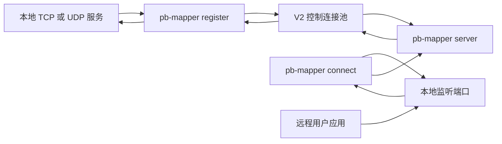
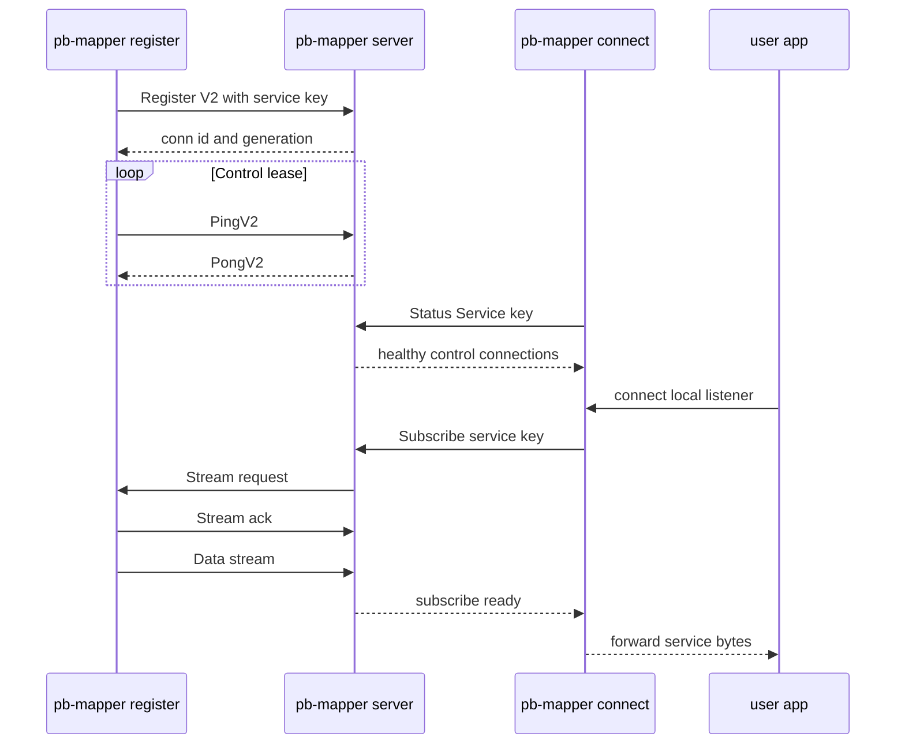

# pb-mapper 使用手册

[English](user-guide.md) | [中文](user-guide.zh-CN.md)

## 概览

pb-mapper 通过“服务 key”将本地 TCP/UDP 服务暴露到公网中继。统一的 `pb-mapper` 二进制提供 `server`、`register`、`connect`、`status`、`admin` 五类命令，并保留可选的 Flutter GUI。

## 运转机制

中继默认仍为 TCP。服务端添加 `--quic-listen 0.0.0.0:7667`，注册端或连接端添加 `--relay-transport quic` 可显式启用 QUIC。保留 TCP 7666 用于认证发现，并开放 UDP 7667；NAT 端口映射可用 `--quic-advertise-port` 指定。此选项独立于直连策略和业务 TCP/UDP 类型，`--relay-only` 不禁用显式配置的 QUIC 中继。详见 [QUIC 中继、SDK 和可观测接口](relay-quic.zh-CN.md)。



`server` 角色是公网会合点。`register` 进程为一个服务 key 注册本地服务，并向中继保持一组长期存在的控制连接。`connect` 进程在对外暴露本地监听端口前，会先确认目标服务 key 下面存在 healthy 的控制连接。

当用户连接 connect 侧的本地监听端口时，该进程会向中继订阅目标服务 key。中继选择一个健康的已注册控制连接，让对应的 register 进程打开数据流，等待 ack 后再把 client 数据流和本地服务之间的字节双向转发起来。



控制连接同时使用租约和接收超时。register 超过容忍窗口后会独立探测精确的 `conn_id` 和 `generation`；注册丢失会触发重连。超过容忍窗口加宽限期仍没有入站控制消息，也会触发重连，即使 status 中还存在这条连接。relay 对单次慢 ACK 先标记 suspect，并等待宽限期内的认证消息确认，不立即注销整个服务。connect 的本地监听持续保留，健康探测在后台进行，控制连接重建也不关闭仍健康的数据流。具体期限、资源上限和故障测试见[弱网恢复设计](weak-network-recovery.md)。

### 直连（默认）

每条新连接都先尝试 P2P 路径：消费端向 relay 申请会话授权，两端通过 relay 的 STUN 服务获知各自的公网 UDP 地址，打通各自的 NAT，再建立双向认证的 QUIC 连接；提供端只在收到 StartDirect 后拨号本地服务。在提交点之前失败会改走中继；提交后失败不会重放或再次拨号后端。回退之后，这条隧道接下来的连接会直接走中继一段时间（10 秒起，翻倍到 5 分钟；直连成功或网络切换时清零）。

双层 NAT 不一定阻止直连，关键是各层的映射和过滤规则。客户端会保留 IPv4/IPv6 候选，并验证认证探测的实际来源地址，因此可以利用部分与 STUN 结果不同的对端映射。公网 IPv6 可达时也能绕开 IPv4 NAT；这仍要求防火墙允许 UDP。双方都无法接收第一包或 UDP 被封锁时继续使用中继，不保证任意 NAT 都能打洞。

自动端口映射是可选能力，默认不编译、不请求网关修改。需要时构建 `cargo build -p pb-mapper-cli --features port-mapping`，在 `register` 或 `connect` 后加 `--port-mapping`。客户端使用 PCP、NAT-PMP 或 UPnP 映射直连 UDP socket，由库续租，本机网络变化时重新发现网关，隧道停止时尝试释放。发现不会延长直连预算，首条连接可能先回退，后续连接才使用已获得的映射。`--relay-only` 不创建映射。只控制家用路由器无法保证穿过运营商 NAT；上游需要可穿透、显式映射或 PCP 代理等配合。Rust SDK 启用同名 Cargo feature 后使用 `client.with_port_mapping(true)?`，原有请求结构无需修改。

直连不需要任何配置：relay 在与 TCP 相同的端口号上监听 UDP，所有角色默认都允许直连。在 `server`、`register` 或 `connect` 上加 `--relay-only` 即可关闭对应一侧的直连。已建立的直连会话归两端所有：relay 重启或凭据吊销只阻止新的建连，不会切断它；停止本地隧道才会关闭它。

## 环境准备

- 可选：Flutter SDK（用于 `ui/` 图形界面）
- 可选：Docker/Compose（容器部署见 `DOCKER_README.md`）

## 安装（推荐）

从 GitHub Releases 下载预编译二进制并解压：

- Releases：https://github.com/acking-you/pb-mapper/releases

每个平台只有一份产物：类 Unix 系统为 `pb-mapper-<target>.tar.gz`，Windows 为 `pb-mapper-<target>.zip`。解压后将 `pb-mapper` 添加到 PATH，或从解压目录直接运行。

### 通过 Cargo 安装

如果机器上已有 Rust 工具链，可以直接从 crates.io 安装同一个统一可执行文件：

```bash
cargo install pb-mapper-cli --locked
```

crate 名称是 `pb-mapper-cli`，安装后的可执行文件名为 `pb-mapper`。它已包含
relay server 以及全部 client/admin 角色，因此 relay 和客户端机器都只需执行
这一条安装命令。

## 从源码编译（可选）

### Rust 二进制

需要 Rust 工具链（版本以 `rust-toolchain.toml` 为准）。

编译 Rust CLI：

```bash
cargo build --release
```

通过 Makefile 编译 CLI：

```bash
make build-pb-mapper
```

交叉编译 musl CLI：

```bash
make build-pb-mapper-x86_64_musl
```

二进制产物位于 `target/release/pb-mapper`。

### Flutter UI（可选）

```bash
cd ui
flutter run
```

## 运行（CLI）

如已加入 PATH 可直接运行，否则前面加 `./`。

### 1）启动中心服务器

```bash
pb-mapper server --port 7666
```

relay 监听 `7666/tcp`，并为直连监听 `7666/udp`。请在防火墙和云安全组同时放行两者；不放行 UDP 时，所有连接仍可经中继工作。

可选参数：

- `--relay-only`（别名 `--disable-direct`）：只提供中继，不开 UDP 端口
- `--direct-listen <ADDR>`：把直连协调绑定到其他地址（默认是 relay 地址的 UDP）
- `--direct-advertise <IP:PORT>`：UDP 端口与 TCP 端口映射不一致时，告诉客户端应使用的公网地址（默认使用客户端拨通 relay 的地址）
- `--ipv6`：开启 IPv6 监听
- `--keep-alive`：开启 TCP keep-alive
- `--auth-state-dir`：认证状态目录（Linux 系统服务默认 `/var/lib/pb-mapper/auth`；无特权 Linux、macOS 与 Windows 使用当前用户可写的应用目录）
- `--max-temporary-keys`：临时 key 固定槽位容量，默认 `65536`
- `--max-temporary-key-ttl`：临时 key 最大 TTL，默认 `30d`
- `--legacy-protocol allow|deny`：旧协议初始接入策略
- `--use-machine-msg-header-key`：明确启用旧版机器派生 key 兼容模式

### 管理员密钥与临时凭据

中继首次启动时会在认证状态目录生成随机管理员密钥（`admin.key`）。Linux 系统服务
默认写到 `/var/lib/pb-mapper/auth/admin.key`；无特权 Linux、macOS 与 Windows
桌面构建则使用当前用户可写的应用目录。系统不再提供内置默认 key。管理员密钥留在
中继机器上，用它为业务签发临时凭据：

```bash
export MSG_HEADER_KEY="$(sudo cat /var/lib/pb-mapper/auth/admin.key)"
pb-mapper admin --server "your-server:7666" \
  key issue --ttl 24h --label my-service
```

把输出的 `pbmt1_...` 凭据导入 register 与 connect 两端。临时 key 只能看到并操作
自己的命名空间：

```bash
export MSG_HEADER_KEY='pbmt1_...'
pb-mapper register tcp --server "your-server:7666" --key "my-service" --addr "127.0.0.1:8080"
```

续期不会改变凭据文本；吊销或到期会立即关闭对应的控制连接与数据连接。完整生命周期、
命名空间、V2 帧格式和迁移步骤见
[`authentication-v2.zh-CN.md`](authentication-v2.zh-CN.md)。

已有部署仍可显式启用机器派生 key，但不建议新安装继续使用：

```bash
pb-mapper server --port 7666 --use-machine-msg-header-key
```

升级时，如果新管理员密钥和 `MSG_HEADER_KEY` 都不存在，中继会自动导入
`/var/lib/pb-mapper-server/msg_header_key`，旧客户端无需立刻换 key。

### 2）注册本地服务

注册 TCP 服务：

```bash
pb-mapper register tcp \
  --server "your-server:7666" \
  --key "my-service" \
  --addr "127.0.0.1:8080"
```

注册 UDP 服务：

```bash
pb-mapper register udp \
  --server "your-server:7666" \
  --key "my-udp" \
  --addr "127.0.0.1:8211"
```

如需为中继流量启用 AES-256-GCM 加密，请在 register 命令中加入 `--codec`。直连会话始终由 QUIC 加密。

加上 `--relay-only` 可以让这项服务的所有会话都只走中继。

### 3）远程客户端连接

```bash
pb-mapper connect tcp \
  --server "your-server:7666" \
  --key "my-service" \
  --addr "127.0.0.1:9090"
```

完成后，远程机器可通过 `127.0.0.1:9090` 访问目标服务。

连接默认先尝试直连（`--path auto`）。使用 `--relay-only`（或 `--path relay-only`）可让这条隧道始终走中继。

### 状态命令

```bash
pb-mapper status remote-id --server "your-server:7666"
pb-mapper status keys --server "your-server:7666"
pb-mapper status sessions --server "your-server:7666"
```

`status sessions` 列出本命名空间内的会话及各自走的路径（`direct` 或 `relay`）。这些是端点上报的观测，带有时间与 `stale` 标记，不代表存活证明。

管理员可明确查看或连接某个临时命名空间：

```bash
pb-mapper status keys --server "your-server:7666" --namespace 4294967296
pb-mapper connect tcp --server "your-server:7666" --namespace 4294967296 \
  --key "my-service" --addr "127.0.0.1:9090"
```

管理员要在临时命名空间注册服务，还必须增加 `--force`。

### 管理命令

```bash
pb-mapper admin --server "your-server:7666" status
pb-mapper admin --server "your-server:7666" key list
pb-mapper admin --server "your-server:7666" key reveal 4294967296
pb-mapper admin --server "your-server:7666" service list --all
pb-mapper admin --server "your-server:7666" connection list --all
pb-mapper admin --server "your-server:7666" connection retire my-service --all
```

自动化场景可使用 `--output json` 输出单个 JSON 文档，或用 `--output ndjson` 流式输出。
默认每页 100 条，最大 1000 条。

`connection retire` 会断开服务器仍为某个服务保留的控制连接。若某个服务明明已经没有
实例在跑，注册却一直返回 `service_connection_limit_exceeded`，说明连接配额被本该消失的
连接占满，此时使用该命令。`--all` 断开该服务的全部连接，健康连接也会被一并中断；
`--conn-id` 只断开 `connection list` 中列出的某一条。服务器本身会定期回收过期租约，
所以这条命令属于手动兜底，而非常规操作。

## 运行（GUI）

Flutter UI 无需命令行即可共享与连接服务。启动方式：

```bash
cd ui
flutter run
```

首次启动时会询问中继地址和本机的连接凭据，然后引导你共享一个服务或连接一个服务。之后共有五个页面：

- **总览**：隧道星图。本机与中继是两颗恒星；每条隧道、中继上的每个服务都是一颗行星，运行中显示为绿色。运行中的隧道是一道光弧：流量经中继时，光弧落进中继这颗恒星；直连时，光弧通体发亮，越过中继直达那项服务的行星。点击行星即可启动、停止、编辑或连接；详情面板会画出流量的路线，并在直连没成功时说明为什么走了中继。
- **隧道**：本机共享的服务和本机连接的服务。每条运行中的隧道都标明流量怎么走：**直连**、**中继**、两者兼有时各自的数量、建立直连时的 **正在直连…**，或 **仅中继**。**新建隧道** 只有一张表单，用“共享 / 连接”切换：服务 Key、本地地址、TCP 或 UDP。
- **中继**：中继是否在线、上面的服务与连接；持有管理员密钥时还有凭据与安全管理。
- **日志**：Rust 侧日志，可按级别和关键词筛选。
- **设置**：中继地址与连接凭据、可在另一台电脑粘贴的配置串、主题与语言。

应用的直连行为与 CLI 相同：每个连接先尝试直连，不通再经中继；每个共享都允许连接直接到达。在隧道表单的 **更多选项** 里可以为单条隧道关闭直连，效果等同 `--relay-only`。

关闭窗口后应用会留在托盘中；从托盘菜单退出。

## 环境变量

- `PB_MAPPER_SERVER`：CLI 默认服务器地址
- `MSG_HEADER_KEY`：32 字符管理员密钥或 `pbmt1_` 临时凭据
- `PB_MAPPER_AUTH_STATE_DIR`：中继认证状态目录（Linux 系统服务默认 `/var/lib/pb-mapper/auth`；无特权 Linux、macOS 与 Windows 使用当前用户可写的应用目录）
- `PB_MAPPER_AUTH_MAX_TEMP_KEYS`：临时 key 固定容量，默认 `65536`
- `PB_MAPPER_AUTH_MAX_TEMP_TTL_SECS`：临时 key 最大 TTL，默认 30 天
- `PB_MAPPER_LEGACY_PROTOCOL`：`allow` 或 `deny`，默认 `allow`
- `PB_MAPPER_MAX_SERVICES_PER_NAMESPACE`：每命名空间 service 数，默认 `256`
- `PB_MAPPER_MAX_REGISTER_CONNECTIONS_PER_SERVICE`：每 service 控制连接数，默认 `16`
- `PB_MAPPER_MAX_STREAMS_PER_NAMESPACE`：每命名空间活动 stream 数，默认 `1024`
- `PB_MAPPER_NEW_STREAMS_PER_SECOND`：每命名空间持续新建 stream 速率，默认 `100`
- `PB_MAPPER_NEW_STREAMS_BURST`：每命名空间新建 stream 突发量，默认 `200`
- `PB_MAPPER_KEEP_ALIVE`：启用 TCP keep-alive（设置为 `ON`）
- `PB_MAPPER_LOG_FORMAT`：tracing 输出格式，可选 `pretty`（默认）、`compact` 或 `json`
- `PB_MAPPER_CONTROL_IO_TIMEOUT`：通用控制 I/O 超时，默认 `30s`；恢复建连采用更短的自适应/总期限，上限 `5s`，配置更小值仍然生效
- `PB_MAPPER_STREAM_ACK_TIMEOUT`：stream ACK 的初始/最小等待预算，默认 `300ms`；各控制连接根据实测延迟和超时调整预算，再切换候选
- `PB_MAPPER_STREAM_READY_TIMEOUT`：收到 ACK 后的最小数据流等待时间，默认 `1s`；至少覆盖自适应 ACK 预算的两倍，并受建流总期限约束
- `PB_MAPPER_STREAM_RECOVERY_TIMEOUT`：等待替代注册的最小窗口，默认 `2s`；同时覆盖 suspect 宽限期 + 初始 ACK 预算 + `200ms`，并受 `5s` 建流总期限约束
- `PB_MAPPER_CONTROL_CONN_POOL_SIZE`：每个注册服务并行保持的服务端控制连接数量，默认 `2`，最大 `16`
- `PB_MAPPER_CONTROL_HEARTBEAT_INTERVAL`：register 角色控制连接心跳间隔，默认 `2s`
- `PB_MAPPER_CONTROL_HEARTBEAT_TOLERANCE`：已注册控制连接多久没有收到入站控制消息后进入 suspect 并触发远端注册探测，默认 `6s`
- `PB_MAPPER_CONTROL_SUSPECT_GRACE`：控制连接持续无入站消息时的额外宽限期，也是 relay 确认失效的最小宽限期，默认 `2s`；status 中仍有记录不能延后接收期限
- `PB_MAPPER_REGISTRATION_PROBE_TIMEOUT`：register 角色每次远端注册状态探测的超时时间，默认 `1s`
- `PB_MAPPER_SERVER_LEASE_TIMEOUT`：server 侧 V2 已注册控制连接的空闲租约超时，默认 `15s`
- `PB_MAPPER_SERVER_LEASE_SWEEP_INTERVAL`：server 回收租约已过期的已注册控制连接的扫描间隔，默认 `5s`。填 0 会回退到默认值：每次扫描都要遍历全部注册，周期为 0 反而会拖垮它本该保护的流量
- `PB_MAPPER_REGISTRATION_REJECT_BACKOFF_MIN` / `_MAX`：register 角色被服务器*拒绝*注册（例如连接配额已满）后的重试等待时间，区别于连不上服务器时的传输重试，默认 `5s` 与 `80s`。任一端填 0 都会回退到默认值；上限低于下限时退化为固定间隔
- `PB_MAPPER_CLIENT_HEALTH_CHECK_INTERVAL`：client 侧本地 listener 重新确认远端 service key 仍已注册的间隔，默认 `15s`
- `PB_MAPPER_CLIENT_HEALTH_CHECK_TIMEOUT`：client 后台 key 健康检查的最长等待时间，默认 `5s`；自适应建连预算可以缩短该期限
- `PB_MAPPER_CLIENT_HEALTH_FAILURE_THRESHOLD`：连续多少次健康检查失败后将状态标记为 `retrying`，默认 `3`；本地 listener 保持监听
- `PB_MAPPER_TUNNEL_IDLE_TIMEOUT`：TCP 隧道双向完全空闲后的关闭时间，默认 `1h`
- `PB_MAPPER_HALF_CLOSE_IDLE_TIMEOUT`：TCP 隧道半关闭后另一方向无数据时的关闭时间，默认 `60s`
- `RUST_LOG`：日志级别，例如 `info` 或 `debug`

超时值支持纯秒数，也支持 `ms`/`s`/`m`/`h` 后缀，例如 `500ms`、`60s`、`10m`、`1h`。

## Docker 部署

服务器容器部署请见 [`DOCKER_README.md`](../DOCKER_README.md)。
